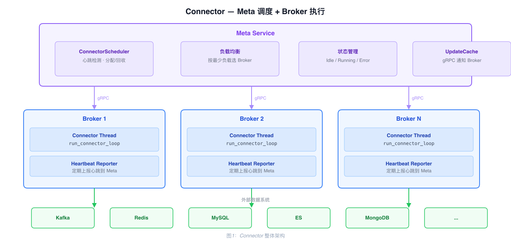
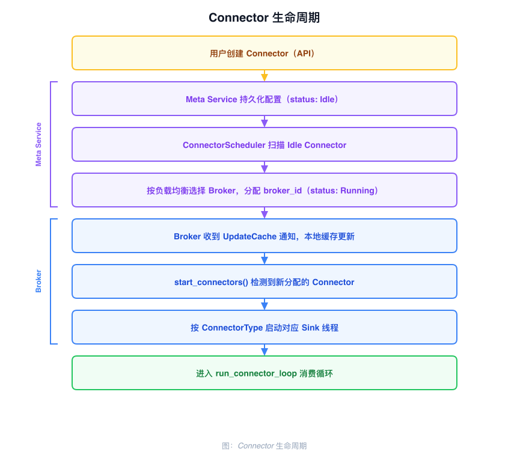
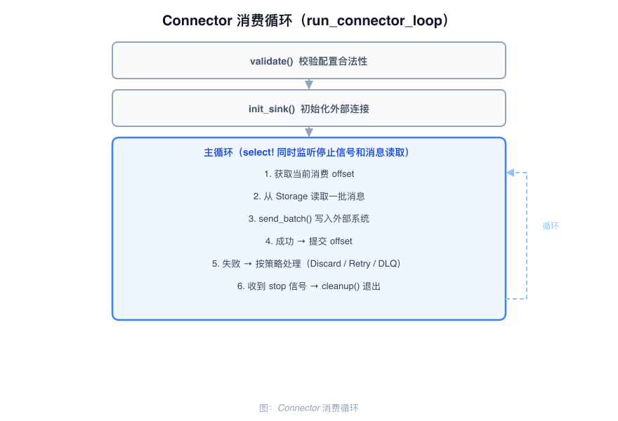

# Connector Architecture

Connectors stream messages from a Broker to external data systems in real time. They run on Broker nodes and are scheduled centrally by the Meta Service.

---

## Overall Structure

The architecture uses Meta for scheduling and Broker for execution:

- `ConnectorScheduler` in Meta Service handles Connector assignment, reclamation, and state management
- Broker nodes execute the actual consume-and-write logic
- State is synchronized between the two via gRPC (UpdateCache)



---

## Lifecycle

A Connector has three states, maintained centrally by Meta Service:

| State | Meaning |
|-------|---------|
| `Idle` | Unassigned; waiting for the scheduler to assign it to a Broker |
| `Running` | Assigned to a Broker; the Broker-side thread is active |
| `Stop` | Stopped; excluded from scheduling until explicitly changed |

State transitions: created as `Idle` → assigned by the scheduler becomes `Running` → heartbeat timeout or Broker down resets it to `Idle` → re-enters scheduling. A stopped Connector uses `Stop` and is not selected while the scheduler only assigns `Idle` Connectors.



---

## Meta Scheduling (ConnectorScheduler)

Two tasks run every second:

**Heartbeat check (check_heartbeat)**: Iterates over all Connectors and checks their last heartbeat time. If a Connector has timed out, it is marked Idle, its broker_id assignment is cleared, and it waits for rescheduling.

**Assignment and reclamation (start_stop_connector_thread)**:
- Collects all Connectors in Idle state
- Calculates load per Broker (number of assigned Connectors)
- Assigns using least-load selection
- Updates status to Running and notifies the Broker via UpdateCache

---

## Broker-Side Scheduling

The Broker's `start_connector_thread` runs two checks every second:

**Start check (start_connectors)**: Iterates over all Connectors in the local cache. If a Connector is assigned to the current Broker and its thread is not running, starts the corresponding Sink thread by `ConnectorType`.

**Reclaim check (gc_connectors)**: Iterates over all running threads. If the corresponding Connector is no longer assigned to the current Broker, sends a stop signal and updates its status to Idle.

---

## Consume Loop (run_connector_loop)

Execution flow for each Connector thread:

1. Check the stop signal; exit the loop if received
2. Call `read_by_offset` on the Storage Adapter to fetch a batch of messages
3. After a successful storage read, update the local heartbeat timestamp (including when the batch is empty)
4. If no messages are available, sleep briefly and retry
5. Call `ConnectorSink::send_batch` to write the messages to the external system
6. On `send_batch` success: commit the consumed offsets, then apply the configured failure policy to any per-record failures returned by the sink
7. On `send_batch` error: apply the configured failure policy; retry without committing, or commit after the failure is terminally handled



---

## ConnectorSink Trait

All external system Connectors implement this interface:

| Method | Description |
|--------|-------------|
| `validate()` | Validate connection configuration |
| `init_sink()` | Initialize external connection resources |
| `send_batch()` | Send a batch of messages to the external system |
| `cleanup_sink()` | Release connection resources |

To add a new Connector type: implement `ConnectorSink`, add the type to the `ConnectorType` enum, and add dispatch logic in `start_thread`.

---

## Failure Handling Policy

When `send_batch` fails, the configured policy determines behavior:

| Policy | Behavior |
|--------|----------|
| `Discard` | Drop the batch and continue consuming the next one |
| `DiscardAfterRetry` | Retry a configured number of times, then discard |
| `DeadMessageQueue` | Retry a configured number of times, then send to dead-letter queue |

---

## Heartbeat Mechanism

**Broker side**: Updates the local heartbeat timestamp after each successful storage read, before checking whether the returned batch is empty. A heartbeat reporting thread periodically batches and sends these updates to Meta Service.

**Meta side**: `ConnectorScheduler` periodically checks heartbeats. Connectors that have timed out are reset to Idle and await rescheduling to a healthy Broker.

---

## Offset Management

Each Connector maintains its own consume progress using `connector_name` as the consumer group name:

- Tracks the maximum offset per Shard on each read
- Commits offsets after `send_batch` returns successfully, before per-record failures returned by the sink are handled
- For a batch-level send error, retries do not commit offsets; offsets are committed only when the configured failure policy reports the batch as terminally handled (for example, discard or successful dead-letter write)
- After a Connector migrates to another Broker, consumption resumes from the last committed offset

---

## Supported External Systems

| Type | Description |
|------|-------------|
| Kafka | Write to a Kafka Topic |
| Elasticsearch | Write to an ES Index |
| Redis | Execute Redis command templates |
| MongoDB | Write to a MongoDB Collection |
| MySQL | Write to a MySQL table |
| PostgreSQL | Write to a PostgreSQL table |
| RabbitMQ | Publish to a RabbitMQ Exchange |
| Pulsar | Publish to a Pulsar Topic |
| GreptimeDB | Write to GreptimeDB |
| LocalFile | Write to a local file |

---

## Code Structure

```
src/connector/src/
├── traits.rs       ConnectorSink trait
├── loops.rs        Consume loop, offset management
├── core.rs         Broker-side scheduling, type dispatch
├── manager.rs      Runtime state management
├── heartbeat.rs    Heartbeat reporting thread
├── failure.rs      Failure handling policy
├── storage/        Meta Service storage interaction
├── kafka/
├── elasticsearch/
├── redis/
├── mongodb/
├── mysql/
├── postgres/
├── rabbitmq/
├── pulsar/
├── greptimedb/
└── file/
```
