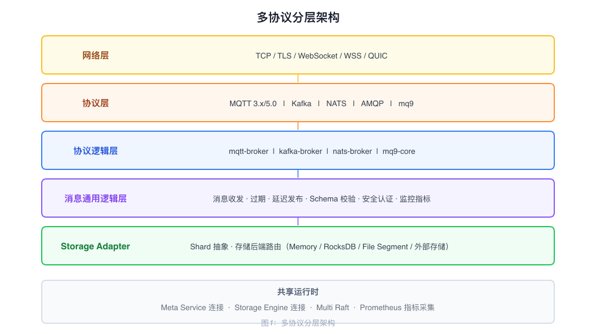

# Multi-Protocol Architecture

RobustMQ supports five protocols — MQTT, Kafka, NATS, AMQP, and mq9 — within a single Broker process. All protocols share the same runtime, storage layer, and cluster coordination components.

---

## Layered Structure

---

## Layer Responsibilities

### Network Layer

Listens on per-protocol ports, handles connection establishment and TLS handshake, and delivers byte streams to the protocol layer for parsing. Five transport modes are supported: TCP, TLS, WebSocket, WebSocket Secure, and QUIC.

### Protocol Layer

Protocol-specific encoding and decoding logic. Parses byte streams into protocol frames and serializes protocol frames back into byte streams. Contains no business logic. The shared implementation is in `src/protocol`, with protocol-specific broker behavior in the corresponding `*-broker` crates. See [Protocol Codec Architecture](./Protocol-Architecture.md) for the internal dispatch and wrapper model.

| Protocol | Status |
|----------|--------|
| MQTT 3.1 / 3.1.1 / 5.0 | Production-ready |
| Kafka | Implemented; compatibility work ongoing |
| NATS | Implemented; compatibility work ongoing |
| AMQP | Implemented; compatibility work ongoing |
| mq9 | Implemented as NATS subject semantics; compatibility work ongoing |

### Protocol Logic Layer

Protocol-specific business modules that handle session management, subscriptions, consumer groups, and other protocol-defined behaviors. Crates for different protocols have no dependencies on each other.

### Common Message Logic Layer

Business capabilities shared across all protocols, called by each protocol logic layer:

| Capability | Description |
|------------|-------------|
| Message expiry | Cleans up messages according to per-Topic TTL configuration |
| Delayed publish | Delivers messages at a specified future time |
| Authentication | Protocol-specific authentication using the shared security infrastructure where supported |
| ACL | Protocol-specific access-control checks where implemented |
| Schema validation | Payload validation for protocol paths that opt into schema checks |
| Metrics | Prometheus metrics collection |

### Storage Adapter

Abstracts each protocol's storage concepts (Topic / Partition / Queue) into a unified Shard, and routes operations to the appropriate storage backend. The Broker has no awareness of the underlying storage type or distribution. See [StorageAdapter-Architecture.md](./StorageAdapter-Architecture.md).

---

## Shared Runtime

All protocols share:

- **Meta Service connection**: Cluster coordination and metadata reads/writes use a shared gRPC connection pool
- **Storage Engine connection**: Message reads and writes share a single storage layer; data is written once
- **Raft state machine**: Cluster consistency is provided by the same Multi-Raft implementation
- **Metrics collection**: Prometheus metrics are exposed on a single shared port

---

## Protocol Isolation Principle

Protocol logic layers have no crate-level dependencies on each other and evolve independently. Protocol-specific concepts (MQTT QoS, Kafka Consumer Group, NATS Subject) do not leak into other layers. Shared capabilities (authentication, Schema validation, metrics) are provided as separate crates and imported on demand by each protocol.

As a result, adding a new protocol does not touch existing protocol code, and changes to one protocol do not affect others.

## Cross-Protocol Message Routing

All protocols use the same Storage Adapter and storage-engine infrastructure, but protocol routing is not an automatic bridge. Topics are created with a protocol-specific source (`MQTT`, `Kafka`, `NATS`, `AMQP`, or `MQ9`), and each protocol applies its own lookup and subscription rules. A protocol can access an existing topic when its handler resolves the same tenant/topic mapping, but this does not make every protocol's subject, queue, and topic interchangeable. In particular, NATS subscription discovery only considers topics created as `NATS` topics, while mq9 uses its own NATS subject namespace and persistence path.

The accurate architectural guarantee is shared storage infrastructure and reusable records, not automatic cross-protocol delivery or topic bridging.

---

## Scope of Adding a New Protocol

Adding a new protocol requires implementing:

1. **Protocol layer**: Encoding/decoding logic to parse protocol frames
2. **Protocol logic layer**: Protocol-specific session, subscription, and consume business logic
3. **Network layer registration**: Register the protocol handler on the corresponding port

The following do not need to be modified: Storage Adapter, Storage Engine, Meta Service, or the common logic layer.
