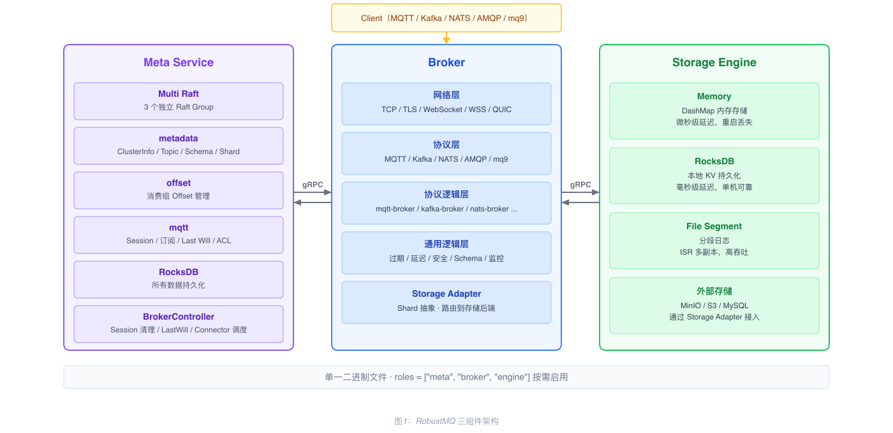
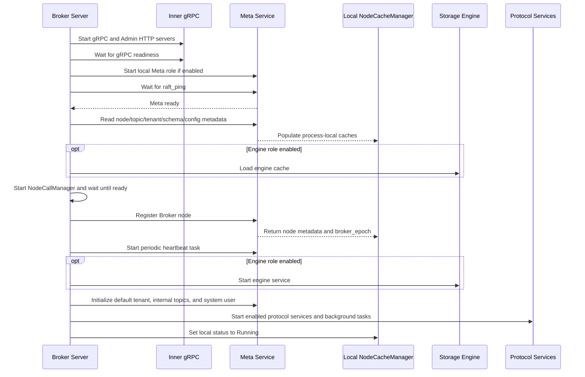
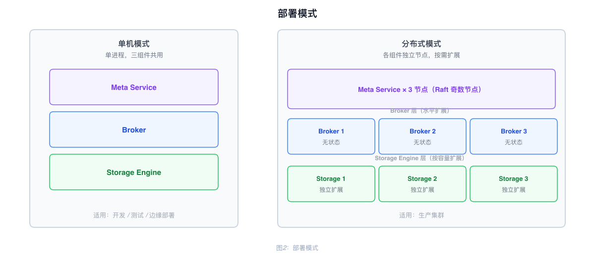

# RobustMQ Overall Architecture

## Components

RobustMQ consists of three core components, delivered as a single binary. The `roles` field in the configuration determines which components are enabled:

```toml
roles = ["meta", "broker", "engine"]
```

| Component | Responsibility |
|-----------|----------------|
| **Meta Service** | Cluster metadata management, node coordination, cluster controller |
| **Broker** | Multi-protocol parsing and message processing (MQTT, Kafka, NATS, AMQP, mq9) |
| **Storage Engine** | Built-in storage engine with Memory, RocksDB, and File Segment backends |

All three components can run together on a single machine, or each can be deployed independently on separate nodes.



---

## Broker Layered Structure

The Broker is a protocol processing layer, organized into the following layers:

| Layer | Description |
|-------|-------------|
| Network Layer | TCP / TLS / WebSocket / WSS / QUIC |
| Protocol Layer | MQTT / Kafka / NATS / AMQP / mq9 protocol parsing |
| Protocol Logic Layer | Per-protocol business modules (mqtt-broker, kafka-broker, etc.) |
| Common Message Logic Layer | Message send/receive, expiration, delayed publishing, authentication, Schema validation, metrics |
| Storage Adapter | Shard abstraction layer that routes write operations to the appropriate storage backend |

The Broker does not persist authoritative cluster metadata or message data; those are owned by the Meta Service and Storage Engine. It does maintain process-local runtime state and caches, including node, tenant, topic, session, share-group, and dynamic-configuration data. Metadata caches such as nodes, tenants, topics, and dynamic configuration are populated from Meta Service during startup and refreshed as metadata changes are received; not every runtime cache is necessarily loaded eagerly.

---

## Inter-Node Communication

Each node starts two servers:

| Server | Protocol | Purpose |
|--------|----------|---------|
| Inner gRPC Server | gRPC | Internal inter-node communication (Meta ↔ Broker ↔ Storage Engine) |
| Admin HTTP Server | HTTP | External operations interface (REST API); also serves Prometheus metrics at `GET /metrics` on the same `http_port` |

---

## Startup Order

For a Broker-enabled node, startup proceeds in this order after configuration and logging initialization:

1. **Start network servers**: Start the Inner gRPC and Admin HTTP servers, then wait for gRPC readiness.
2. **Start and check Meta Service**: Start the local Meta Service when its role is enabled, then wait until Meta responds to `raft_ping`.
3. **Load metadata caches**: Load nodes, dynamic configuration, topics, tenants, schemas, share groups, security data, and protocol-specific metadata into process-local caches. Load Storage Engine cache data when the engine role is enabled.
4. **Start node-to-node calls**: Start the NodeCallManager and wait until it is ready.
5. **Register and heartbeat**: Register the Broker node with Meta Service, save the returned `broker_epoch`, and start a heartbeat task that runs every 3 seconds; each heartbeat request has a 3-second timeout.
6. **Start engine and initialize defaults**: Start the Storage Engine service when enabled; initialize the default tenant, internal topics, and system user.
7. **Start protocol services**: Start enabled protocol services and background tasks. The local node status changes from `Starting` to `Running` after startup completes; handlers that require readiness wait for this status.

Prometheus metrics are served by the Admin HTTP server at `GET /metrics`; there is no separate Prometheus server or port.

Registration retries peer-not-ready errors for up to 30 attempts with a 2-second delay. Heartbeats are sent to every configured Meta address; if Meta reports that the node no longer exists, the Broker attempts to register again.



---

## Deployment Modes

**Standalone mode**: All three components run in a single process. Suitable for development, testing, and edge deployments.

**Distributed mode**: Each component is deployed on separate nodes and scaled independently. Typical configuration:

- Meta Service: 3 or 5 nodes (odd number for Raft quorum)
- Broker: horizontally scaled based on traffic; authoritative metadata and message data remain outside the Broker process
- Storage Engine: scaled based on storage capacity


