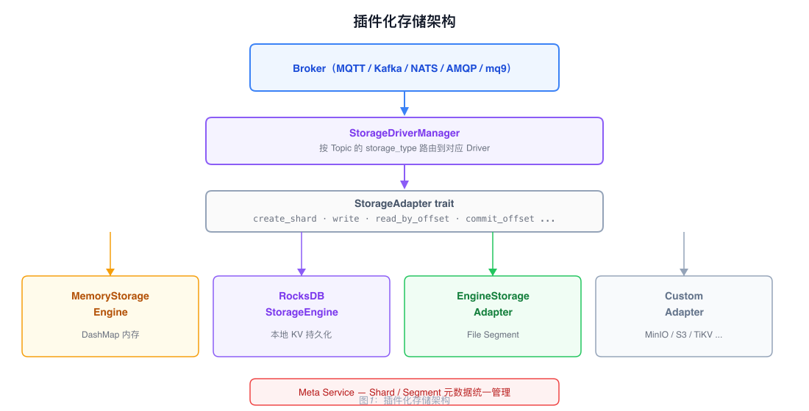
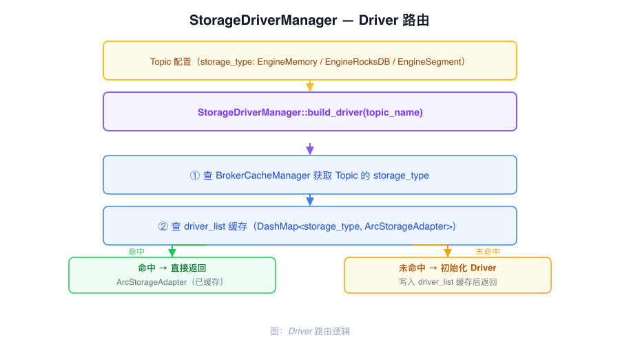

# Pluggable Storage Architecture

RobustMQ decouples the Broker from its storage backend through the `StorageAdapter` trait. The current broker path supports Memory, RocksDB, and File Segment engines through one adapter implementation; external storage types are declared in configuration but are rejected by `StorageDriverManager` until a driver branch is implemented and enabled.

---

## StorageAdapter Trait

```rust
#[async_trait]
pub trait StorageAdapter {
    async fn create_shard(&self, shard: &AdapterShardInfo) -> Result<(), CommonError>;
    async fn list_shard(&self, shard: Option<String>) -> Result<Vec<AdapterShardDetail>, CommonError>;
    async fn delete_shard(&self, shard: &str) -> Result<(), CommonError>;
    async fn write(&self, shard: &str, data: &[AdapterWriteRecord], acks: i8)
        -> Result<Vec<AdapterWriteRespRow>, CommonError>;
    async fn read_by_offset(&self, shard: &str, offset: u64, config: &AdapterReadConfig)
        -> Result<Vec<StorageRecord>, CommonError>;
    async fn read_by_tag(&self, shard: &str, tag: &str, start_offset: Option<u64>, config: &AdapterReadConfig)
        -> Result<Vec<StorageRecord>, CommonError>;
    async fn read_by_keys(&self, shard: &str, keys: &[&[u8]])
        -> Result<HashMap<Vec<u8>, Vec<StorageRecord>>, CommonError>;
    async fn delete_by_keys(&self, shard: &str, keys: &[&[u8]]) -> Result<(), CommonError>;
    async fn delete_by_offsets(&self, shard: &str, offsets: &[u64]) -> Result<(), CommonError>;
    async fn delete_records_before(&self, shard: &str, target_offset: u64)
        -> Result<u64, CommonError>;
    async fn get_offset_by_timestamp(&self, shard: &str, timestamp: u64, strategy: AdapterOffsetStrategy)
        -> Result<u64, CommonError>;
    async fn close(&self) -> Result<(), CommonError>;
}
```

Consumer-group offsets are deliberately outside this trait. `StorageDriverManager`
delegates `get_offset_by_group`, `commit_group_offset`, and `delete_group_offset` to
`common-group::OffsetManager`.

---

## Supported Storage Engines



| Storage type | Engine path | Description |
|--------------|-------------|-------------|
| `EngineMemory` | `EngineStorageAdapter` → `StorageEngineHandler` → `MemoryStorageEngine` | In-memory records; data is lost on process restart |
| `EngineRocksDB` | `EngineStorageAdapter` → `StorageEngineHandler` → `RocksDBStorageEngine` | Local RocksDB-backed record storage |
| `EngineSegment` | `EngineStorageAdapter` → `StorageEngineHandler` → File Segment | Segmented log storage |

These are engine backends behind the same `EngineStorageAdapter` implementation;
they are not separate implementations of the `StorageAdapter` trait.

---

## Routing Mechanism

`StorageDriverManager` selects the implementation based on the `storage_type` configured on the Topic:



Routing logic: when the Broker writes a message, it first reads the target Topic's `storage_type` field from `NodeCacheManager`, then looks up an already-initialized Driver instance in `driver_list` (`DashMap<String, ArcStorageAdapter>`). On a cache miss, the private `get_storage_driver_by_topic` method creates an `EngineStorageAdapter` for `EngineMemory`, `EngineRocksDB`, or `EngineSegment`, stores it in the map, and returns it. Other `StorageType` values return an unsupported-storage-type error. Driver instances are typed as `Arc<dyn StorageAdapter>` and shared across requests.

Different Topics within the same cluster can use different supported storage backends (mixed storage). A Topic's selected storage type is copied to all of its Shards; partitions within one Topic do not select different engines through the normal creation path.

---

## Integrating External Storage

External storage is an extension point, not an enabled runtime feature. The current
`Mysql`, `MinIO`, and `S3` enum values are rejected by `StorageDriverManager`; enabling
one requires:

1. Create a new struct that implements all methods of `StorageAdapter`
2. Add and enable the corresponding `storage_type` branch in `StorageDriverManager::get_storage_driver_by_topic`
3. Specify the new `storage_type` in the Topic configuration

---

## Shard and Segment Metadata

Shard and Segment metadata for all storage backends is managed centrally by Meta Service:

- Shard creation, deletion, and partition configuration are stored in Meta Service's metadata Raft Group
- Shard placement, segment 0 creation, and File Segment `active_segment`/leader/ISR metadata are coordinated through Meta Service
- Brokers cache hot data in a local `StorageCacheManager` to reduce round-trips to Meta Service
