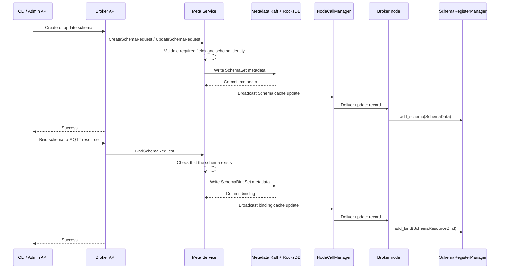
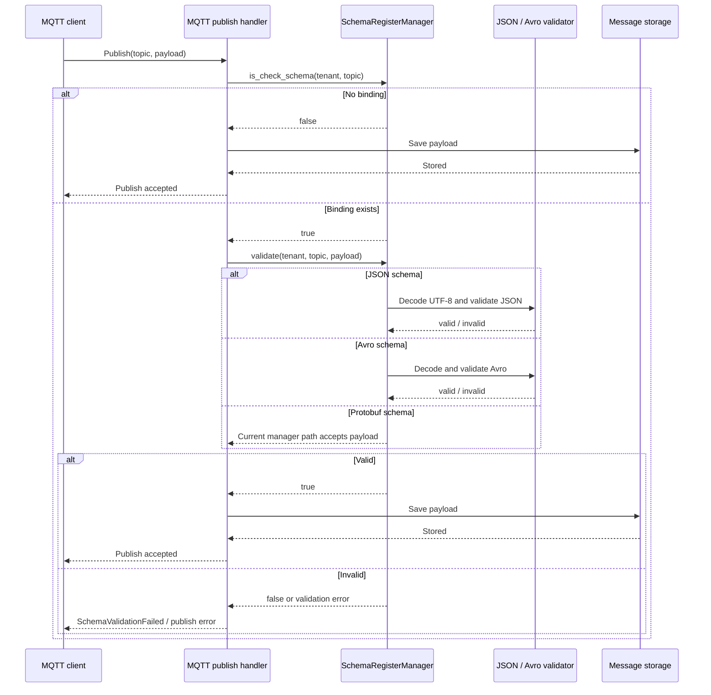

# Schema Registry Architecture

RobustMQ's schema registry provides tenant-scoped schema management and MQTT
payload validation. The registry has two parts:

- **Control plane**: Meta Service stores schemas and schema-to-resource bindings
  as cluster metadata and replicates changes through Raft.
- **Data plane**: Each Broker keeps an in-memory `SchemaRegisterManager` cache
  and checks bound MQTT publish payloads before writing them to storage.

The in-memory cache is not the source of truth. A Broker rebuilds it from Meta
Service at startup and updates it when Meta Service broadcasts a metadata change.

## Data Model

Every schema contains:

| Field | Meaning |
|-------|---------|
| `tenant` | Tenant that owns the schema |
| `name` | Schema identifier within the tenant |
| `schema_type` | `json`, `avro`, or `protobuf` |
| `schema` | The format-specific schema text |
| `desc` | Human-readable description |

A binding connects a schema to a resource name, which is the MQTT topic used by
the publish path. Both the schema and binding are tenant-scoped.

## Management Flow

The CLI and Admin HTTP API call the Meta Service through the Broker's schema
storage adapter. Schema creation, update, deletion, binding, and unbinding are
metadata operations; they are not local-only cache mutations.

The delete and unbind paths use the corresponding `SchemaDelete` and
`SchemaBindDelete` metadata records and remove the entries from each Broker's
cache.

## Broker Startup and Recovery

When a Broker starts, it loads all schemas and all bindings from Meta Service:

1. `SchemaStorage.list(None, None)` reads the persisted schemas.
2. Each schema is inserted into `SchemaRegisterManager`.
3. `SchemaStorage.list_bind(None)` reads the persisted bindings.
4. Each binding is inserted into `SchemaRegisterManager`.

This makes the cache disposable and allows a restarted Broker to resume schema
validation without recreating configuration.

## MQTT Publish Flow

Schema validation is applied only to resources that have a binding for the
publishing tenant and topic. An unbound topic keeps the existing behavior and
accepts the payload without schema validation.

## Format Behavior

| Format | Current validation path |
|--------|-------------------------|
| JSON | Payload bytes are converted to UTF-8 and validated with the stored JSON Schema. Invalid JSON or schema input returns an error; a valid JSON document can still fail schema validation and return `false`. |
| Avro | The stored Avro schema is parsed and the payload is decoded with it. Parse, decode, or record errors are returned. |
| Protobuf | `schema-register` exposes `protobuf_validate` for direct validation, but the current `SchemaRegisterManager::validate` branch does not call it. A Protobuf binding therefore currently falls through as accepted data. |

The Protobuf behavior is an implementation limitation, not a claim that
arbitrary Protobuf payloads are semantically validated. A future change that
wires message-name selection and `protobuf_validate` into the manager should
update this section and add matching tests.

## Runtime Configuration Status

The MQTT configuration reference documents `mqtt_runtime.schema.enable`,
`strategy`, `failed_operation`, `echo_log`, and `log_level`. The current publish
handler does not read these fields when deciding whether to validate a payload;
it uses the presence of a tenant/topic binding instead. The current manager also
validates the first matching JSON or Avro schema and does not implement the
documented `ALL` versus `Any` strategy or failure-operation policy. Treat those
configuration fields as reserved configuration surface until the runtime wiring
is completed.

## Deletion and Binding Notes

- Schema and binding state is replicated metadata, so changes are eventually
  reflected in every Broker through cache-update notifications.
- The current manager removes a schema entry and a binding entry separately.
  Deleting a schema does not automatically remove its binding records.
- Operators should unbind a schema before deleting it. If a stale binding remains
  without a schema entry, the manager still detects that the resource is bound,
  but its validation loop has no schema to validate and returns accepted data.
- Bindings and schemas are isolated by tenant; the same schema name or topic can
  exist independently in different tenants.

## Related Documentation

- [MQTT schema CLI commands](../RobustMQ-Command/CLI_MQTT)
- [MQTT schema management API](../Api/MQTT#10-schema-management)
- [Meta Service Architecture](./MetaService-Architecture)
- [Multi-Protocol Architecture](./MultiProtocol-Architecture)
