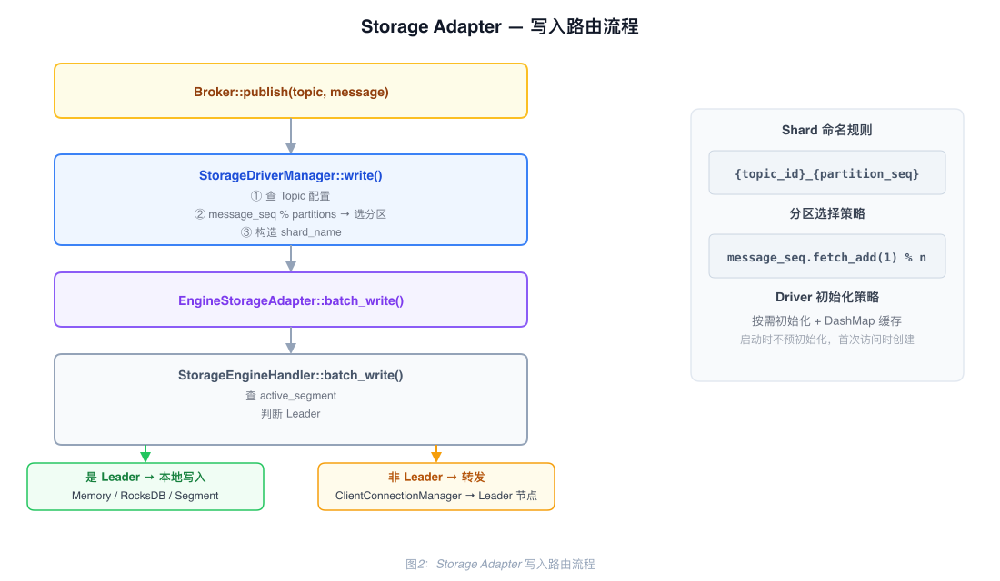
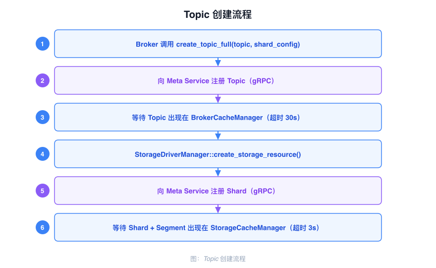
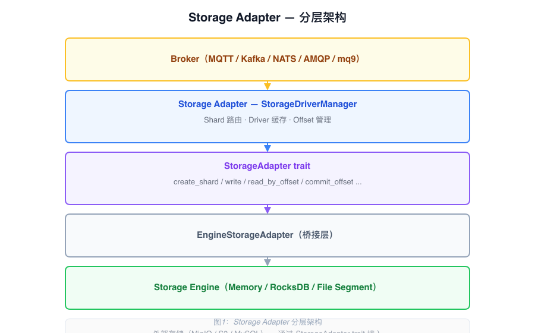

# Storage Adapter Architecture

The Storage Adapter sits between the Broker and the Storage Engine. It maps storage concepts from different protocols to a unified Shard abstraction and routes read/write operations to the appropriate storage backend.

---

## Shard Abstraction

Storage concepts from each protocol are mapped to Shard:

| Protocol | Original Concept | Mapped To |
|----------|-----------------|-----------|
| MQTT | Topic | Shard |
| Kafka | Partition | Shard |
| AMQP | Queue | Shard |

One Topic maps to a group of Shards (multiple partitions). Naming convention:

```
{topic_id}-{partition}
```

Each Topic selects one storage type (`EngineMemory`, `EngineRocksDB`, or `EngineSegment`), and that setting is copied into the configuration of every Shard belonging to the Topic. Shard and Segment metadata are managed centrally by the Meta Service.

---

## Core Components

### StorageAdapter trait

The unified interface that all storage backends implement:

| Method | Description |
|--------|-------------|
| `create_shard(&AdapterShardInfo)` | Create a Shard through the storage engine handler |
| `list_shard(Option<String>)` | List all Shards or one named Shard |
| `delete_shard(&str)` | Delete a Shard |
| `write(&str, &[AdapterWriteRecord], i8)` | Write one batch to one Shard and return response rows |
| `read_by_offset` | Read records from one Shard starting at an Offset |
| `read_by_tag` | Read tagged records from one Shard |
| `read_by_keys` | Read records for multiple keys from one Shard |
| `delete_by_keys` / `delete_by_offsets` | Delete records by keys or offsets where the engine supports it |
| `delete_records_before` | Apply DeleteRecords semantics and return the achieved low watermark |
| `get_offset_by_timestamp` | Look up an Offset by timestamp and strategy |
| `close` | Close the adapter |

Consumer-group offset operations (`get_offset_by_group`, `commit_group_offset`, and
`delete_group_offset`) are methods on `StorageDriverManager` and are backed by
`common-group::OffsetManager`; they are not part of the `StorageAdapter` trait.

### StorageDriverManager

The entry point component called directly by the Broker:

| Field | Type | Description |
|-------|------|-------------|
| `driver_list` | `DashMap<String, ArcStorageAdapter>` | Caches initialized drivers by storage type |
| `engine_storage_handler` | `Arc<StorageEngineHandler>` | Underlying engine handler |
| `broker_cache` | `Arc<NodeCacheManager>` | Local Topic metadata cache, queried during routing |
| `offset_manager` | `Arc<OffsetManager>` | Consumer group Offset management |
| `message_seq` | `AtomicU64` | Global write sequence number, used for round-robin partition selection |

Drivers are initialized on demand and cached to avoid repeated creation.

### EngineStorageAdapter

Implements the `StorageAdapter` trait and delegates calls to `StorageEngineHandler`. This is the bridge layer between the Storage Adapter and the Storage Engine.

---

## Write Path

When the Broker receives a message, it calls `StorageDriverManager::write`, which proceeds as follows:

1. Look up the Topic's partition count, storage type, and `storage_name_list` from `NodeCacheManager`
2. Fetch-and-increment `message_seq`, then select one target Shard by modulo: `storage_name_list[seq % partition_count]`
3. Look up the matching Driver in `driver_list`; if not found, initialize it on demand and cache it
4. Call the Driver's `write` method with the complete input slice and return the resulting response rows

The batch is not split across partitions: every record in one `write` call is sent to
the one selected Shard. Kafka can bypass round-robin selection with
`write_to_partition`, which resolves the requested partition and sends the complete
batch there.



---

## Topic Creation Flow

When a Topic is created, the protocol broker sends the Topic metadata to Meta Service
and then provisions each storage Shard through the adapter:

1. The client requests Topic creation; the protocol broker builds a `Topic` with its partition count, replication, storage type, and topic limits.
2. `create_topic_full` sends the Topic to Meta Service, which persists it and propagates it to the broker cache.
3. After the local cache observes the Topic, `StorageDriverManager::create_storage_resource` iterates over `storage_name_list`.
4. Each Shard is created through the storage-engine handler, which asks Meta Service to persist the Shard and creates segment 0. `EngineSegment` additionally requires segment metadata; Memory and RocksDB shards do not.



---

## Offset Management

`OffsetManager` keeps consumer-group offsets in an in-memory `DashMap` on each
broker. `commit_group_offset` updates that local cache synchronously and marks the
group dirty. `get_offset` reads the local cache first and falls back to Meta Service
on a cache miss. A background task checks dirty groups every 20 ms and flushes them
to Meta Service; the local cache is therefore immediately visible while persistence
is asynchronous. If a flush fails, the error is logged after the dirty-group set has
been cleared, so the same update is not immediately retried by that loop; a later
commit or group heartbeat must mark the group dirty again.

`GroupConsumer` can auto-commit after a successful read, or use `new_manual` and
commit explicitly. `PriorityGroupConsumer` maintains separate critical, urgent, and
normal group offsets and reads in that order.

The `offset_enable_cache` broker setting belongs to storage-engine offset handling;
it is not the implementation switch for consumer-group offsets described here.

---

## Layer Relationships


