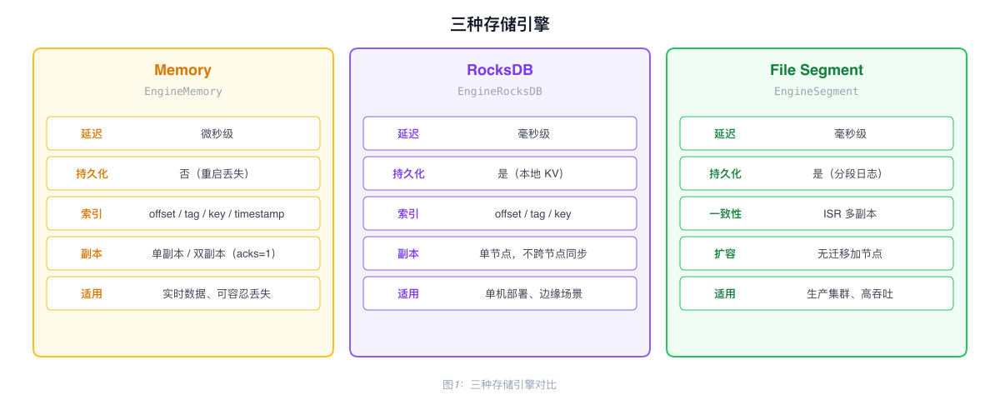
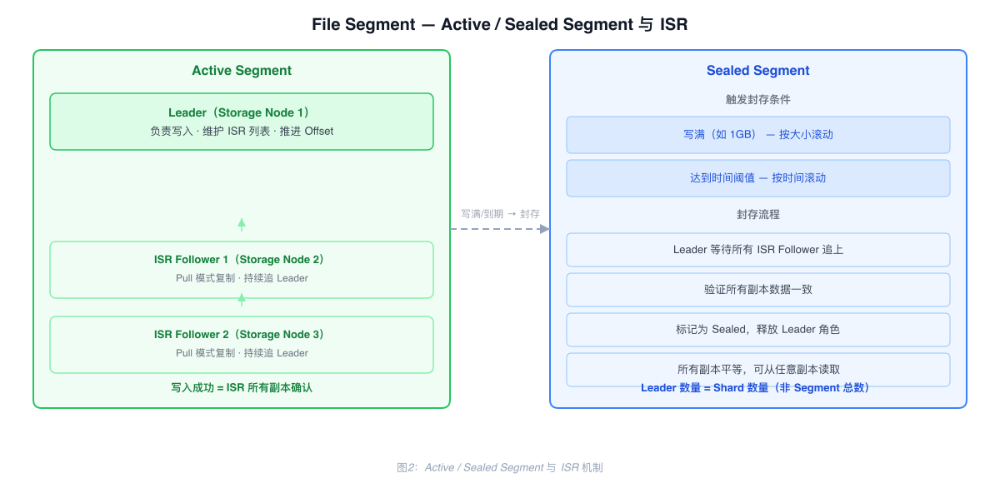
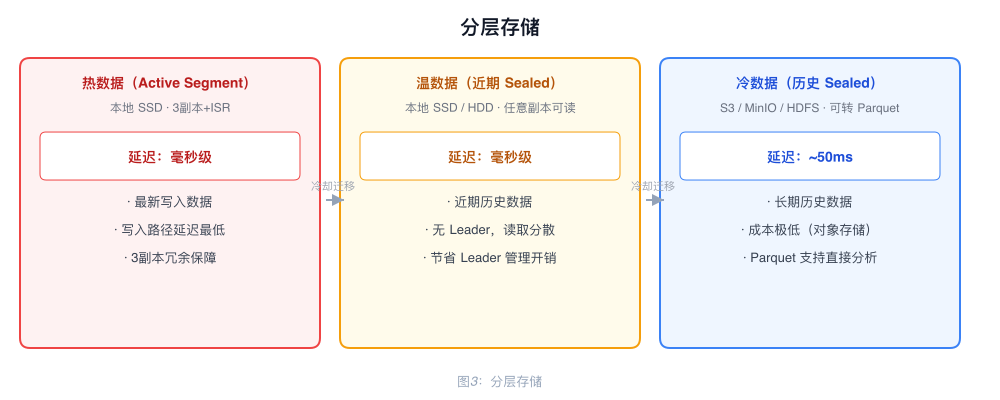

# Storage Engine Architecture

RobustMQ provides three storage engines. The Storage Adapter shields the upper-layer Broker from the differences between them, and storage type is configured independently per Topic.

---

## Three Storage Engines

| Engine | Config Value | Latency | Persistent | Use Case |
|--------|-------------|---------|------------|----------|
| Memory | `EngineMemory` | Microseconds | No | Real-time data, data loss acceptable |
| RocksDB | `EngineRocksDB` | Milliseconds | Yes | Single-node persistence, edge deployment |
| File Segment | `EngineSegment` | Milliseconds | Yes | Production clusters, high throughput |

---

## Memory Engine

Pure in-memory storage based on `DashMap`, supporting four index types:

| Index | Structure | Purpose |
|-------|-----------|---------|
| Primary data | `DashMap<shard, DashMap<offset, Record>>` | Read by Offset |
| Tag index | `DashMap<shard, DashMap<tag, Vec<offset>>>` | Query by Tag |
| Key index | `DashMap<shard, DashMap<key, offset>>` | Query by Key (Key is unique) |
| Timestamp index | `DashMap<shard, DashMap<timestamp, offset>>` | Look up Offset by time |

Data is lost when the process restarts. In a replicated shard, the Leader writes locally and Followers pull the data asynchronously; the producer's `acks` value controls whether the write waits for replication.

---

## RocksDB Engine

Stores messages using a dedicated Column Family (`DB_COLUMN_FAMILY_BROKER`), with an in-memory write lock per Shard to prevent concurrent write conflicts.

The data is persisted locally and is not shared through RocksDB between nodes. In cluster mode, replication is provided by the storage-engine ISR protocol rather than by a shared RocksDB instance; this engine is intended for local persistence rather than the File Segment engine's production-cluster workload.

---

## File Segment Engine

A production-grade storage engine for clustered deployments, supporting multiple replicas, high throughput, and tiered storage.

### I/O Pool

A fixed number of I/O Workers (default 16) manage all Partitions. Each Partition maps to a Worker via `partition_id % worker_count`, so requests for the same Partition always route to the same Worker, preserving write order.

Workers process in batches: block waiting for the first request, then non-blockingly collect subsequent requests. A single batch can aggregate hundreds to thousands of messages, all persisted in one fsync.

Messages use `Bytes` (Arc reference counting) for zero-copy from network receive to disk write — the data exists in one copy, with references held in different places.

### Indexes

RocksDB stores four index types: offset index, time index, key index, and tag index.

Indexes are built synchronously with data writes: when a Worker batch-processes N records, it simultaneously builds all indexes for those N records and writes them via RocksDB WriteBatch in a single operation. One I/O for data files, one I/O for indexes.

The offset index uses a sparse index strategy: one index point per 1000 records, recording the file position for that Offset. On query, the nearest index point is located, then sequential scan covers at most 1000 records. 10 million records require approximately 240KB of index space, with query latency around 2ms.

### Consistency Protocol: ISR

Each Active Segment has one Leader, which maintains an ISR (In-Sync Replicas) list. Followers pull records from the Leader. The durability guarantee depends on the requested `acks` value: `acks=1` returns after the local write, while `acks=all` waits for the high watermark (HW) to reach the written offset and also requires the configured minimum ISR size.

Followers pull data from the Leader in batches (Pull mode). In high-QPS scenarios, this reduces network requests from millions to hundreds.

acks configuration:

| acks | Semantics |
|------|-----------|
| `0` | Do not wait for a producer response |
| `1` | Wait only for the Leader's local write |
| `all` / `-1` | Require `min_in_sync_replicas`, then wait for the ISR-derived HW |

`quorum` is not a supported value in the current Kafka produce protocol. The storage engine treats every value other than `-1` as a non-`acks=all` write; protocol validation accepts only `0`, `1`, and `-1`.

### Active Segment and Sealed Segment

**Active Segment**: The currently-written segment. Has a Leader and ISR mechanism; Followers continuously Pull and replicate.

**Sealed Segment**: When a segment reaches its configured end condition, the storage engine asynchronously requests a seal from Meta Service. Meta Service transitions the segment out of the write state; sealed and historical segments are read-only and do not participate in the active-segment leader rotation. The current seal request path does not perform a separate synchronous wait for every ISR follower, so sealing must not be interpreted as an `acks=all` confirmation barrier. Reads are served from the replicas that retain the sealed segment.

Result: Leader count equals Shard count (not total Segment count). 1000 Shards require only 1000 Leaders. Historical data reads are distributed across all Storage Nodes.

### Scale-Out

When adding a new Storage Node, no historical data is migrated. Once the current Active Segment fills up, new Segments are automatically assigned to the new node.

### Tiered Storage

Sealed Segments are immutable and can be uploaded directly to S3 from any replica. Updating the metadata completes the migration.

| Data Tier | Storage Location | Latency |
|-----------|-----------------|---------|
| Hot (Active Segment) | Local SSD | Milliseconds |
| Warm (Recent Sealed) | Local SSD/HDD | Milliseconds |
| Cold (Historical Sealed) | S3 / MinIO / HDFS | ~50ms |

Cold data migrated to S3 can be converted to Parquet format, making it directly queryable by analytics tools such as Spark and Hive.

---

## Two File Models

| Model | Description | Use Case |
|-------|-------------|----------|
| Partition-per-file | Each Partition has its own file, similar to Kafka | Low latency, high throughput, moderate Topic count |
| Shared-file | Multiple Partitions share a file, similar to RocketMQ | Massive Topics/Partitions |
