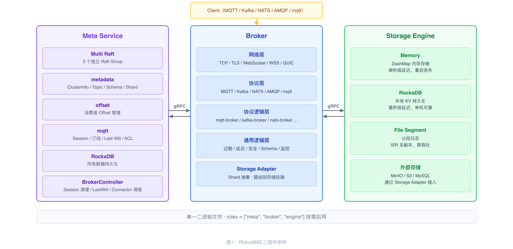
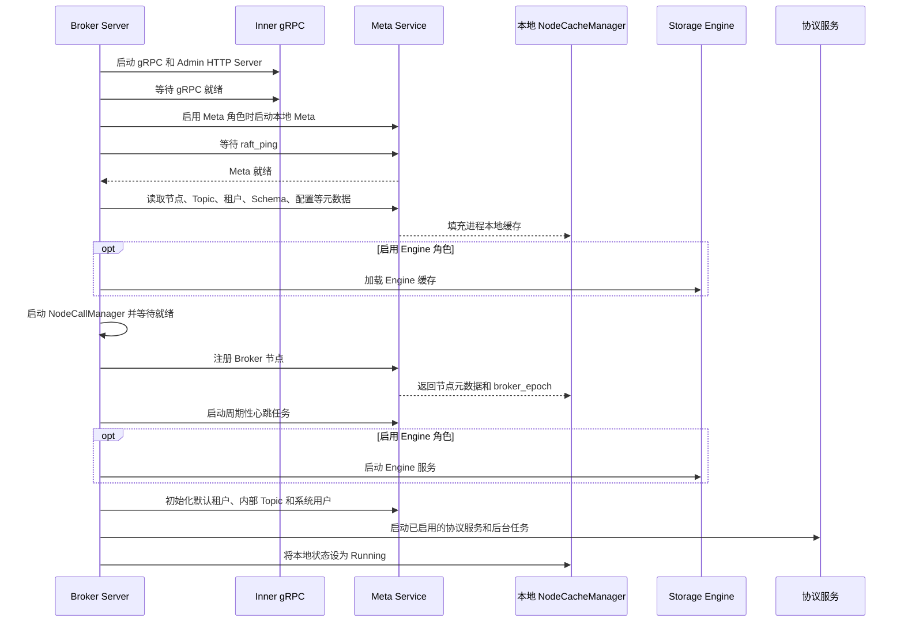
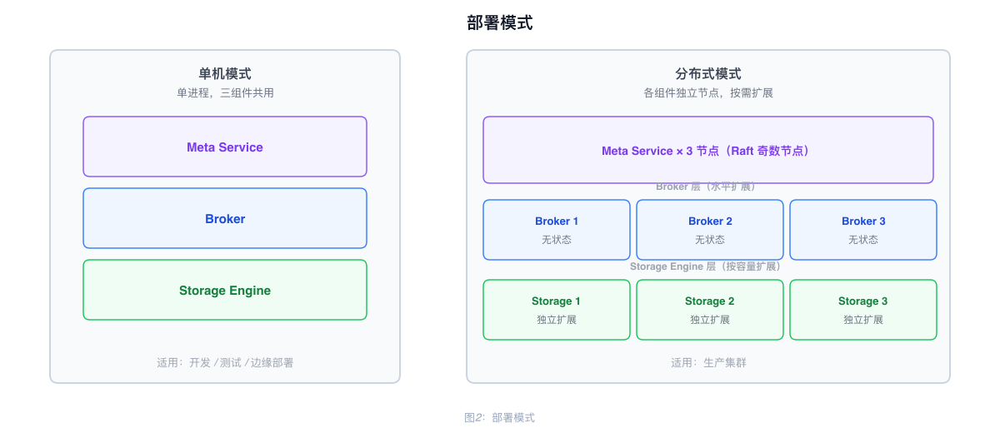

# RobustMQ 整体架构

## 组件构成

RobustMQ 由三个核心组件构成，通过单一二进制文件交付，由配置中的 `roles` 字段决定启用哪些组件：

```toml
roles = ["meta", "broker", "engine"]
```

| 组件 | 职责 |
|------|------|
| **Meta Service** | 集群元数据管理、节点协调、集群控制器 |
| **Broker** | 多协议解析与消息处理（MQTT、Kafka、NATS、AMQP、mq9） |
| **Storage Engine** | 内置存储引擎，提供 Memory / RocksDB / File Segment 三种后端 |

三个组件可单机全启，也可按节点独立部署。



---

## Broker 分层结构

Broker 是协议处理层，内部按以下层次组织：

| 层次 | 说明 |
|------|------|
| 网络层 | TCP / TLS / WebSocket / WSS / QUIC |
| 协议层 | MQTT / Kafka / NATS / AMQP / mq9 协议解析 |
| 协议逻辑层 | 各协议独立的业务模块（mqtt-broker、kafka-broker 等） |
| 消息通用逻辑层 | 消息收发、过期、延迟发布、安全认证、Schema 校验、监控指标 |
| Storage Adapter | Shard 抽象层，将写操作路由到对应存储后端 |

Broker 不持久化权威集群元数据或消息数据；这些数据分别由 Meta Service 和 Storage Engine 管理。但 Broker 进程会维护本地运行状态和缓存，包括节点、租户、Topic、Session、共享订阅组和动态配置等数据。节点、租户、Topic、动态配置等元数据缓存会在启动时从 Meta Service 加载，并在收到元数据变更时更新；并非所有运行时缓存都会在启动时一次性加载。

---

## 节点间通信

每个节点启动两个 Server：

| Server | 协议 | 用途 |
|--------|------|------|
| Inner gRPC Server | gRPC | 节点间内部通信（Meta ↔ Broker ↔ Storage Engine） |
| Admin HTTP Server | HTTP | 对外运维接口（REST API）；同时在同一个 `http_port` 上通过 `GET /metrics` 暴露 Prometheus 指标 |

---

## 启动顺序

对于启用了 Broker 的节点，配置和日志初始化完成后，启动顺序如下：

1. **启动网络服务**：启动 Inner gRPC 和 Admin HTTP Server，并等待 gRPC 就绪。
2. **启动并检查 Meta Service**：如启用了 Meta 角色，则启动本地 Meta Service；随后等待 `raft_ping` 成功。
3. **加载元数据缓存**：将节点、动态配置、Topic、租户、Schema、共享订阅组、安全数据和各协议元数据加载到进程本地缓存。启用 Engine 角色时，同时加载 Storage Engine 缓存。
4. **启动节点间调用**：启动 NodeCallManager 并等待其就绪。
5. **注册并发送心跳**：向 Meta Service 注册 Broker 节点，保存返回的 `broker_epoch`，并启动每 3 秒执行一次的心跳任务；单次心跳请求超时为 3 秒。
6. **启动 Engine 并初始化默认资源**：如启用了 Storage Engine，则启动 Engine 服务；初始化默认租户、内部 Topic 和系统用户。
7. **启动协议服务**：启动已启用的协议服务和后台任务。启动流程完成后，本地节点状态从 `Starting` 变为 `Running`；依赖就绪状态的处理逻辑会等待该状态。

Prometheus 指标由 Admin HTTP Server 在 `GET /metrics` 提供，不存在独立的 Prometheus Server 或端口。

节点注册遇到“对端尚未就绪”错误时，最多重试 30 次，每次间隔 2 秒。心跳会发送到所有配置的 Meta 地址；如果 Meta 返回节点不存在，Broker 会尝试重新注册。



---

## 部署模式

**单机模式**：三个组件运行在同一个进程内，适合开发、测试、边缘场景。

**分布式模式**：三个组件分别部署在不同节点，独立扩展。典型配置：

- Meta Service：3 或 5 节点（Raft 奇数节点）
- Broker：按流量水平扩展；权威元数据和消息数据保存在 Broker 进程之外
- Storage Engine：按存储容量扩展


