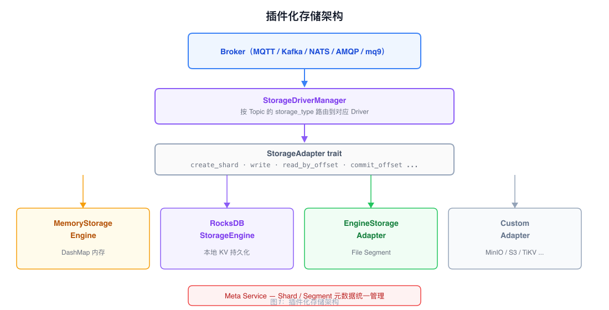
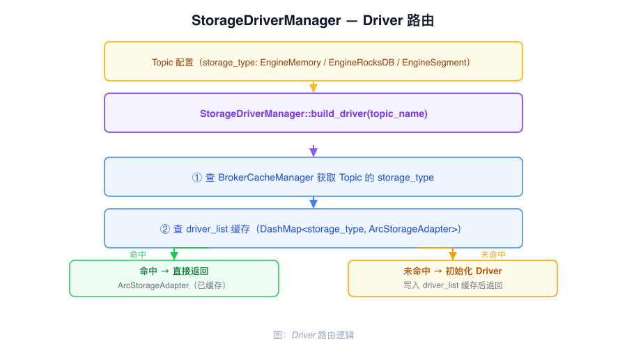

# 插件化存储架构

RobustMQ 通过 `StorageAdapter` trait 将 Broker 与存储后端解耦。当前 Broker 路径通过统一适配器支持 Memory、RocksDB 和 File Segment；配置中虽然声明了外部存储类型，但在 `StorageDriverManager` 增加并启用对应驱动前会被拒绝。

---

## StorageAdapter trait

```rust
#[async_trait]
pub trait StorageAdapter {
    async fn create_shard(&self, shard: &AdapterShardInfo) -> Result<(), CommonError>;
    async fn list_shard(&self, shard: Option<String>) -> Result<Vec<AdapterShardDetail>, CommonError>;
    async fn delete_shard(&self, shard: &str) -> Result<(), CommonError>;
    async fn write(&self, shard: &str, data: &[AdapterWriteRecord], acks: i8)
        -> Result<Vec<AdapterWriteRespRow>, CommonError>;
    async fn read_by_offset(&self, shard: &str, offset: u64, config: &AdapterReadConfig)
        -> Result<Vec<StorageRecord>, CommonError>;
    async fn read_by_tag(&self, shard: &str, tag: &str, start_offset: Option<u64>, config: &AdapterReadConfig)
        -> Result<Vec<StorageRecord>, CommonError>;
    async fn read_by_keys(&self, shard: &str, keys: &[&[u8]])
        -> Result<HashMap<Vec<u8>, Vec<StorageRecord>>, CommonError>;
    async fn delete_by_keys(&self, shard: &str, keys: &[&[u8]]) -> Result<(), CommonError>;
    async fn delete_by_offsets(&self, shard: &str, offsets: &[u64]) -> Result<(), CommonError>;
    async fn delete_records_before(&self, shard: &str, target_offset: u64)
        -> Result<u64, CommonError>;
    async fn get_offset_by_timestamp(&self, shard: &str, timestamp: u64, strategy: AdapterOffsetStrategy)
        -> Result<u64, CommonError>;
    async fn close(&self) -> Result<(), CommonError>;
}
```

消费组 Offset 有意不放在该 trait 中。`StorageDriverManager` 将
`get_offset_by_group`、`commit_group_offset` 和 `delete_group_offset` 委托给
`common-group::OffsetManager`。

---

## 当前支持的存储引擎



| 存储类型 | 引擎调用路径 | 说明 |
|------|--------|------|
| `EngineMemory` | `EngineStorageAdapter` → `StorageEngineHandler` → `MemoryStorageEngine` | 内存记录，进程重启后丢失 |
| `EngineRocksDB` | `EngineStorageAdapter` → `StorageEngineHandler` → `RocksDBStorageEngine` | 基于本地 RocksDB 的记录存储 |
| `EngineSegment` | `EngineStorageAdapter` → `StorageEngineHandler` → File Segment | 分段日志存储 |

以上是同一个 `EngineStorageAdapter` 后面的引擎实现，并不是分别实现
`StorageAdapter` trait 的多个适配器。

---

## 路由机制

`StorageDriverManager` 按 Topic 配置的 `storage_type` 选择对应实现：



路由逻辑：Broker 写入消息时，先从 `NodeCacheManager` 读取目标 Topic 的 `storage_type` 字段，再从 `driver_list`（`DashMap<String, ArcStorageAdapter>`）查找已初始化的 Driver 实例。未命中则由私有方法 `get_storage_driver_by_topic` 为 `EngineMemory`、`EngineRocksDB` 或 `EngineSegment` 创建 `EngineStorageAdapter`，写入缓存后返回。其他 `StorageType` 会返回不支持的存储类型错误。Driver 实例是 `Arc<dyn StorageAdapter>` 类型，可在请求之间共享。

同一集群内不同 Topic 可以使用不同的已支持存储后端（混合存储）。Topic 选择的存储类型会复制到该 Topic 的所有 Shard，正常创建流程不支持同一 Topic 的不同分区选择不同引擎。

---

## 接入外部存储

外部存储目前只是扩展点，并未启用运行时支持。当前 `Mysql`、`MinIO` 和 `S3`
枚举值会被 `StorageDriverManager` 拒绝；要启用一种外部存储，需要：

1. 创建新的 struct，实现 `StorageAdapter` 所有方法
2. 在 `StorageDriverManager::get_storage_driver_by_topic` 中添加并启用对应的 `storage_type` 分支
3. 在 Topic 配置中指定新的 `storage_type`

---

## Shard 与 Segment 元数据

所有存储后端的 Shard 和 Segment 元数据统一由 Meta Service 管理：

- Shard 的创建、删除、分区配置存储在 Meta Service 的 metadata Raft Group
- Shard 放置、segment 0 创建，以及 File Segment 的 active_segment、Leader、ISR 元数据通过 Meta Service 协调
- Broker 通过本地 `StorageCacheManager` 缓存热数据，减少对 Meta Service 的访问
