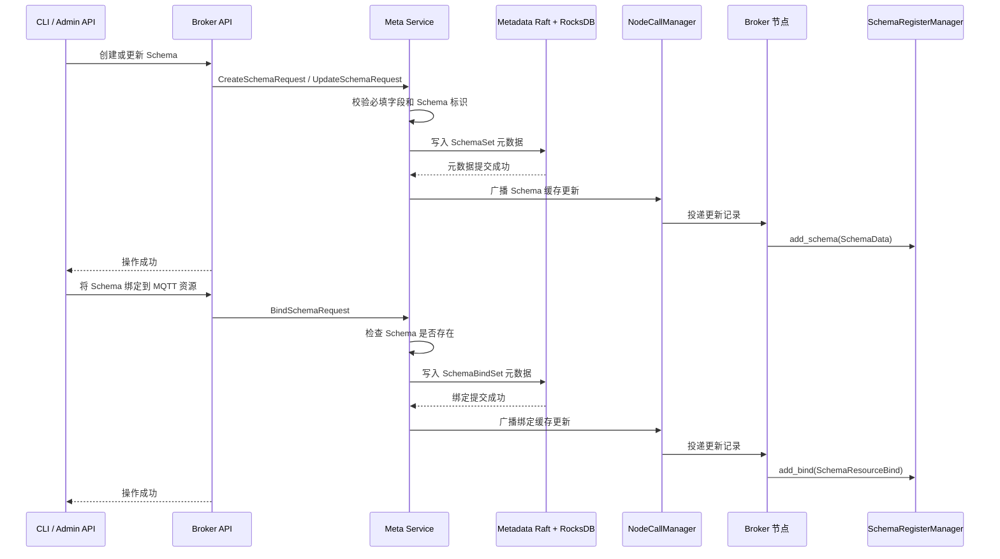
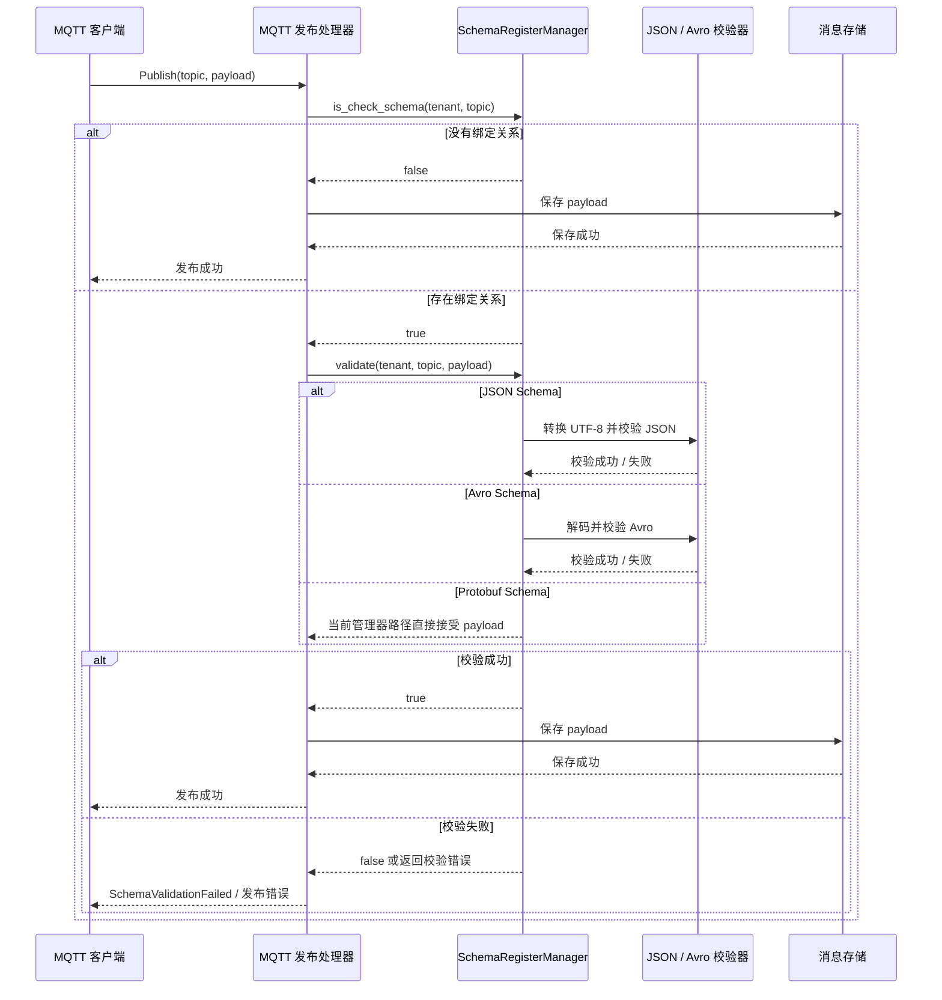

# Schema Registry 架构

RobustMQ 的 Schema Registry 提供按租户隔离的 Schema 管理，以及 MQTT 消息
payload 校验能力。它由两部分组成：

- **控制面**：Meta Service 将 Schema 和 Schema 与资源的绑定关系作为集群元数据
  保存，并通过 Raft 复制变更。
- **数据面**：每个 Broker 在内存中维护 `SchemaRegisterManager` 缓存，在消息写入
  存储前检查已绑定的 MQTT 发布消息。

内存缓存不是最终数据源。Broker 启动时会从 Meta Service 重建缓存；运行过程中，
Meta Service 通过元数据变更通知更新各 Broker 的缓存。

## 数据模型

每个 Schema 包含以下信息：

| 字段 | 说明 |
|------|------|
| `tenant` | Schema 所属租户 |
| `name` | 租户内的 Schema 标识 |
| `schema_type` | `json`、`avro` 或 `protobuf` |
| `schema` | 对应格式的 Schema 文本 |
| `desc` | 面向用户的描述 |

绑定关系将 Schema 连接到资源名称。对于 MQTT 发布流程，资源名称就是用于匹配的
Topic。Schema 和绑定关系都按租户隔离。

## 管理流程

CLI 和 Admin HTTP API 通过 Broker 的 Schema 存储适配器调用 Meta Service。Schema
的创建、更新、删除、绑定和解绑都是元数据操作，不是只修改本地缓存。

删除和解绑流程分别使用 `SchemaDelete` 和 `SchemaBindDelete` 元数据记录，随后
从各 Broker 的缓存中删除对应条目。

## Broker 启动和恢复

Broker 启动时从 Meta Service 加载全部 Schema 和绑定关系：

1. `SchemaStorage.list(None, None)` 读取已持久化的 Schema。
2. 将每个 Schema 写入 `SchemaRegisterManager`。
3. `SchemaStorage.list_bind(None)` 读取已持久化的绑定关系。
4. 将每个绑定关系写入 `SchemaRegisterManager`。

因此缓存可以随时丢弃和重建，Broker 重启后不需要重新创建配置即可恢复 Schema
校验能力。

## MQTT 发布流程

只有当发布租户和 Topic 存在 Schema 绑定关系时，才会执行 Schema 校验。没有绑定
关系的 Topic 保持现有行为，payload 不经过 Schema 校验即可继续处理。

## 各格式的当前行为

| 格式 | 当前校验路径 |
|------|--------------|
| JSON | 将 payload 字节转换为 UTF-8，并使用保存的 JSON Schema 校验。非法 JSON 或非法 Schema 会返回错误；合法 JSON 也可能因为不符合 Schema 而返回 `false`。 |
| Avro | 解析保存的 Avro Schema，并使用它解码 payload。Schema 解析、解码或记录错误会返回错误。 |
| Protobuf | `schema-register` 提供了可直接调用的 `protobuf_validate`，但当前 `SchemaRegisterManager::validate` 没有调用它。因此 Protobuf 绑定目前会直接走接受路径。 |

Protobuf 的行为是当前实现限制，并不代表任意 Protobuf payload 都完成了语义校验。
后续如果将消息名称选择和 `protobuf_validate` 接入管理器，需要同步更新本节并补充
对应测试。

## 运行时配置状态

MQTT 配置文档中定义了 `mqtt_runtime.schema.enable`、`strategy`、
`failed_operation`、`echo_log` 和 `log_level`。当前发布处理器在决定是否校验
payload 时不会读取这些字段，而是根据租户和 Topic 是否存在绑定关系来决定。当前
管理器也只校验第一个匹配到的 JSON 或 Avro Schema，尚未实现文档中描述的 `ALL`
与 `Any` 策略以及失败操作策略。在运行时接线完成前，应将这些配置项视为预留的
配置接口。

## 删除和绑定注意事项

- Schema 和绑定关系属于复制的集群元数据，变更通过缓存更新通知最终同步到所有
  Broker。
- 当前管理器分别删除 Schema 条目和绑定条目。删除 Schema 不会自动删除它的绑定
  记录。
- 运维上应先解绑再删除 Schema。如果残留绑定找不到对应 Schema，管理器仍会判断资源
  已绑定，但校验循环没有可用 Schema，最终会返回接受结果。
- 绑定和 Schema 都按租户隔离；不同租户可以独立使用相同的 Schema 名称或 Topic。

## 相关文档

- [MQTT Schema CLI 命令](../RobustMQ-Command/CLI_MQTT)
- [MQTT Schema 管理 API](../Api/MQTT#10-schema-管理)
- [Meta Service 架构](./MetaService-Architecture)
- [多协议架构](./MultiProtocol-Architecture)
