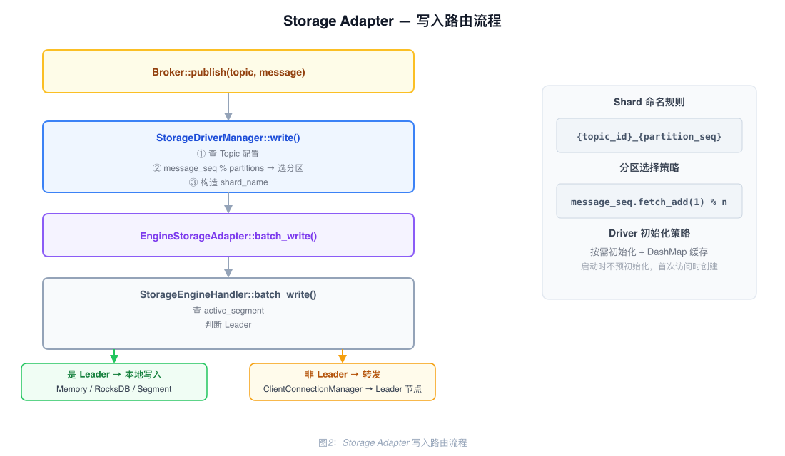
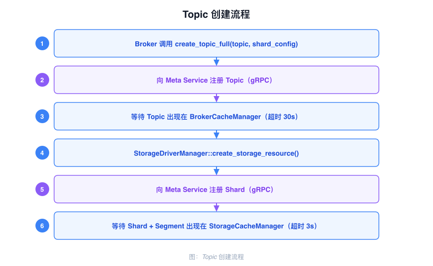
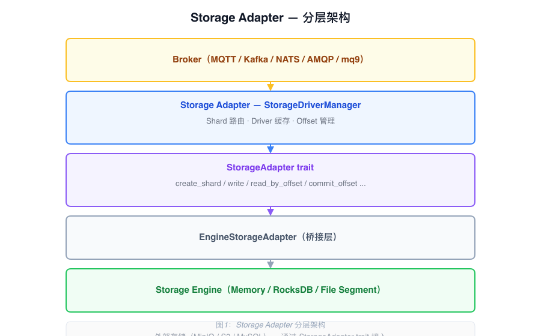

# Storage Adapter 架构

Storage Adapter 位于 Broker 和 Storage Engine 之间，将不同协议的存储概念统一抽象为 Shard，并将读写操作路由到对应的存储后端。

---

## Shard 抽象

各协议的存储概念统一映射为 Shard：

| 协议 | 原始概念 | 映射 |
|------|---------|------|
| MQTT | Topic | Shard |
| Kafka | Partition | Shard |
| AMQP | Queue | Shard |

一个 Topic 对应一组 Shard（多分区），命名规则：

```
{topic_id}-{partition}
```

每个 Topic 选择一种存储类型（`EngineMemory`、`EngineRocksDB` 或 `EngineSegment`），该配置会复制到该 Topic 所有 Shard 的配置中。Shard 和 Segment 元数据由 Meta Service 统一管理。

---

## 核心组件

### StorageAdapter trait

所有存储后端实现的统一接口：

| 方法 | 说明 |
|------|------|
| `create_shard(&AdapterShardInfo)` | 通过存储引擎处理器创建 Shard |
| `list_shard(Option<String>)` | 列出全部 Shard 或指定 Shard |
| `delete_shard(&str)` | 删除 Shard |
| `write(&str, &[AdapterWriteRecord], i8)` | 将一个批次写入一个 Shard，并返回响应行 |
| `read_by_offset` | 从指定 Shard 的 Offset 开始读取记录 |
| `read_by_tag` | 从指定 Shard 读取带 Tag 的记录 |
| `read_by_keys` | 从指定 Shard 按多个 Key 读取记录 |
| `delete_by_keys` / `delete_by_offsets` | 按 Key 或 Offset 删除记录（由引擎能力决定） |
| `delete_records_before` | 执行 DeleteRecords 语义并返回实际低水位 |
| `get_offset_by_timestamp` | 按时间戳和策略查找 Offset |
| `close` | 关闭适配器 |

消费组 Offset 操作（`get_offset_by_group`、`commit_group_offset`、
`delete_group_offset`）属于 `StorageDriverManager`，由 `common-group::OffsetManager`
提供，不是 `StorageAdapter` trait 的方法。

### StorageDriverManager

Broker 直接调用的入口组件：

| 字段 | 类型 | 说明 |
|------|------|------|
| `driver_list` | `DashMap<String, ArcStorageAdapter>` | 按存储类型缓存已初始化的 Driver |
| `engine_storage_handler` | `Arc<StorageEngineHandler>` | 底层引擎处理器 |
| `broker_cache` | `Arc<NodeCacheManager>` | 本地 Topic 元数据缓存，路由时查询 |
| `offset_manager` | `Arc<OffsetManager>` | 消费组 Offset 管理 |
| `message_seq` | `AtomicU64` | 全局写入序号，用于轮询分区选择 |

Driver 按需初始化并缓存，避免重复创建。

### EngineStorageAdapter

实现 `StorageAdapter` trait，将接口调用委托给 `StorageEngineHandler`，是 Storage Adapter 与 Storage Engine 之间的桥接层。

---

## 写入流程

Broker 收到消息后，调用 `StorageDriverManager::write` 进入写入流程：

1. 从 `NodeCacheManager` 查找 Topic 的分区数、存储类型和 `storage_name_list`
2. 用 `message_seq.fetch_add(1)` 取自增序号，对分区数取模，从 `storage_name_list` 选出一个目标 Shard
3. 从 `driver_list` 查找对应存储类型的 Driver，不存在则按需初始化并缓存
4. 调用 Driver 的 `write` 方法，将完整输入切片写入并返回响应行

一个 `write` 调用不会把批次拆到多个分区：批次中的所有记录都会写入同一个目标 Shard。Kafka 可以通过 `write_to_partition` 绕过轮询，显式解析目标分区后把完整批次写入该分区。



---

## Topic 创建流程

创建 Topic 时，协议 Broker 先向 Meta Service 写入 Topic 元数据，再通过 Adapter 为每个存储 Shard 创建资源：

1. 客户端请求创建 Topic，协议 Broker 构造包含分区数、副本数、存储类型和 Topic 限制的 `Topic`。
2. `create_topic_full` 将 Topic 发送给 Meta Service；Meta Service 持久化并把变更传播到 Broker 缓存。
3. 本地缓存观察到 Topic 后，`StorageDriverManager::create_storage_resource` 遍历 `storage_name_list`。
4. 每个 Shard 通过 storage-engine handler 创建，由 Meta Service 持久化 Shard 并创建 segment 0。`EngineSegment` 还需要 Segment 元数据，Memory 和 RocksDB Shard 不需要。



---

## Offset 管理

`OffsetManager` 在每个 Broker 内使用内存 `DashMap` 保存消费组 Offset。`commit_group_offset`
会同步更新本地缓存并标记消费组为脏数据；`get_offset` 优先读取本地缓存，未命中时才访问 Meta Service。
后台任务每 20 ms 检查脏消费组并异步刷入 Meta Service，因此本地读取立即可见，但持久化是异步的。
如果刷入失败，错误会被记录，但脏组集合已先被清空，所以该循环不会立即重试同一更新；需要后续提交或组心跳再次标记该组为脏。

`GroupConsumer` 默认在成功读取后自动提交，也可以使用 `new_manual` 后显式调用 `commit`。
`PriorityGroupConsumer` 为 critical、urgent、normal 分别维护消费组 Offset，并按该顺序读取。

Broker 配置中的 `offset_enable_cache` 属于 storage-engine 的 Offset 处理，不是这里消费组 Offset 的实现开关。

---

## 分层关系


