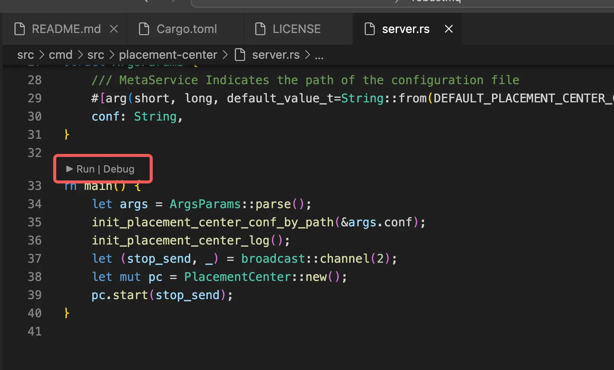

# VSCode运行
下载项目代码
初始化环境
当前架构使用一个 Broker 二进制。在仓库根目录运行：
```
make run
```

在 VSCode 中调试时选择 `broker-server` 二进制，并将
`--conf=config/server.toml` 作为程序参数。该 Broker 会同时启动配置中的
`meta`、`broker` 和 `engine` 角色。终端中对应的启动命令是 `make run`：


