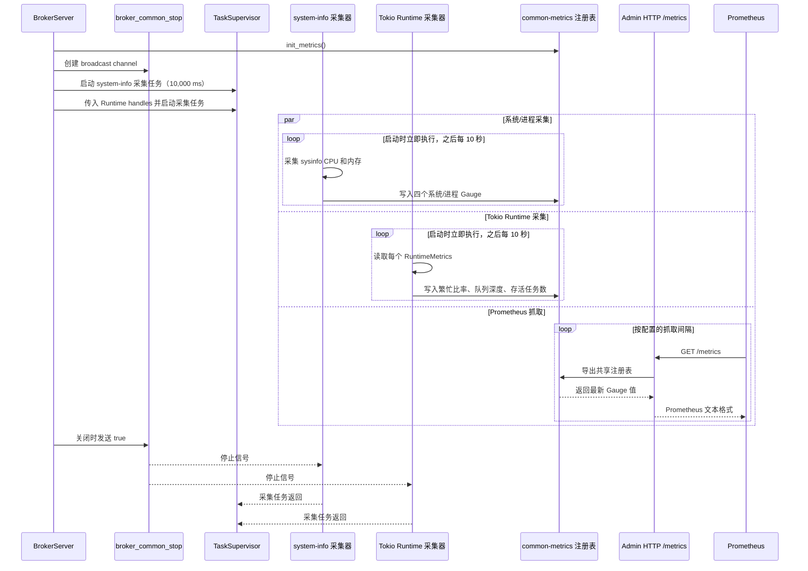

# 基础设施指标

RobustMQ 提供了全面的基础设施监控指标，帮助运维人员监控系统的健康状态、性能表现和资源使用情况。所有指标都基于 Prometheus 格式，可以通过 `/metrics` 端点获取。

> **注意**：Counter 类型指标在 Prometheus 中会自动追加 `_total` 后缀。例如代码中注册为 `grpc_requests` 的 Counter，在 Prometheus/Grafana 中查询时应使用 `grpc_requests_total`。下文表格中的指标名称为 **Prometheus 暴露名称**（Counter 已包含 `_total`）。

## 网络层指标 (Network)

### 请求处理指标

| 指标名称 | 类型 | 标签 | 描述 |
|---------|------|------|------|
| `handler_total_ms` | Histogram | `network` | 从请求接收到响应写出的端到端总耗时（毫秒） |
| `handler_queue_wait_ms` | Histogram | `network` | 请求在 Handler 队列中的等待时长（毫秒） |
| `handler_apply_ms` | Histogram | `network` | command.apply() 处理请求的执行时长（毫秒） |
| `handler_write_ms` | Histogram | `network` | 将响应写回客户端的耗时（毫秒） |
| `write_client_ms` | Histogram | `network` | 将响应写入客户端 Socket 的耗时（毫秒） |

### 队列指标

| 指标名称 | 类型 | 标签 | 描述 |
|---------|------|------|------|
| `handler_queue_size` | Gauge | `label` | Handler 队列中的待处理请求数量 |
| `handler_queue_remaining` | Gauge | `label` | Handler 队列剩余容量 |

### 请求统计指标

| 指标名称 | 类型 | 标签 | 描述 |
|---------|------|------|------|
| `handler_requests_total` | Counter | `network` | Handler 处理的请求总数 |
| `handler_slow_requests_total` | Counter | `network` | 超过阈值的慢请求总数 |
| `handler_timeout_total` | Counter | `network` | Handler apply 超时总数 |
| `write_timeout_total` | Counter | `network` | 响应写入超时总数 |

### 线程指标

| 指标名称 | 类型 | 标签 | 描述 |
|---------|------|------|------|
| `broker_active_thread_num` | Gauge | `network`, `thread_type` | Broker 各类型活跃线程数 |

### Handler 实例指标

| 指标名称 | 类型 | 标签 | 描述 |
|---------|------|------|------|
| `handler_instance_requests_total` | Counter | `handler` | 各 Handler 线程处理的请求总数 |
| `handler_instance_apply_ms` | Histogram | `handler` | 各 Handler 线程的 command.apply() 延迟（毫秒） |

**标签说明：**

| 标签名 | 取值范围 | 说明 |
|-------|---------|------|
| `network` | `Tcp`、`Tls`、`Websocket`、`Websockets`、`Quic`、`Unknown` | 网络连接类型；`Unknown` 表示记录指标时无法获取连接类型 |
| `thread_type` | `accept`、`handler` | 线程类型 |
| `label` | 自定义字符串 | 队列标签，标识特定队列实例 |

## gRPC 服务端指标

| 指标名称 | 类型 | 标签 | 描述 |
|---------|------|------|------|
| `grpc_requests_total` | Counter | `service`, `method` | gRPC 请求总数 |
| `grpc_errors_total` | Counter | `service`, `method`, `status_code` | gRPC 错误总数 |
| `grpc_request_duration_ms` | Histogram | `service`, `method` | gRPC 请求耗时（毫秒） |

## gRPC 客户端指标

| 指标名称 | 类型 | 标签 | 描述 |
|---------|------|------|------|
| `grpc_client_call_duration_ms` | Histogram | `service`, `method` | gRPC 客户端调用耗时（毫秒），包含重试和 Leader 转发 |

**标签说明：**
- `service`: gRPC 服务名（如 `MqttService`, `PlacementService`, `EngineService`）
- `method`: gRPC 方法名（如 `CreateSession`, `ListUser`）
- `status_code`: gRPC 状态码（仅服务端错误指标）

## HTTP 服务指标

| 指标名称 | 类型 | 标签 | 描述 |
|---------|------|------|------|
| `http_requests_total` | Counter | `method`, `uri` | HTTP 请求总数 |
| `http_errors_total` | Counter | `method`, `uri`, `status_code` | HTTP 错误总数 |
| `http_request_duration_ms` | Histogram | `method`, `uri` | HTTP 请求耗时（毫秒） |

**标签说明：**
- `method`: HTTP 方法（GET, POST, PUT, DELETE）
- `uri`: 请求路径
- `status_code`: HTTP 状态码

## 存储层指标 (RocksDB)

| 指标名称 | 类型 | 标签 | 描述 |
|---------|------|------|------|
| `rocksdb_operation_count_total` | Counter | `source`, `operation` | RocksDB 操作次数 |
| `rocksdb_operation_ms` | Histogram | `source`, `operation` | RocksDB 操作耗时（毫秒） |

### Storage Engine 指标

| 指标名称 | 类型 | 标签 | 描述 |
|---------|------|------|------|
| `storage_engine_ops_total` | Counter | `operation` | Storage Engine 操作总数 |
| `storage_engine_ops_fail_total` | Counter | `operation` | Storage Engine 操作失败总数 |
| `storage_engine_ops_duration_ms` | Histogram | `operation` | Storage Engine 操作耗时（毫秒） |

**Storage Engine 操作取值：** `write`、`read_offset`、`read_key`、`read_tag`、`create_shard`、`delete_shard`、`delete_by_key`、`delete_by_offset`、`get_offset_by_timestamp`、`get_offset_by_group`、`commit_offset`、`delete_records_before`

**标签说明：**
- `source`: 数据源（如 metadata, session, message 等）
- `operation`: RocksDB 指标使用 `save`、`get`、`exist`、`delete`、`delete_range`、`list`；Storage Engine 指标使用上面列出的操作值。

## Raft 共识层指标

### 写入指标

| 指标名称 | 类型 | 标签 | 描述 |
|---------|------|------|------|
| `raft_write_requests_total` | Counter | `machine` | Raft 写请求总数 |
| `raft_write_success_total` | Counter | `machine` | Raft 写入成功总数 |
| `raft_write_failures_total` | Counter | `machine` | Raft 写入失败总数 |
| `raft_write_duration_ms` | Histogram | `machine` | Raft 写入操作耗时（毫秒） |
| `raft_apply_batch_duration_ms` | Histogram | `machine` | 单次 Raft apply 批处理耗时（毫秒） |
| `raft_log_append_batch_duration_ms` | Histogram | `machine` | 单次 Raft 日志追加批处理耗时（毫秒） |

### RPC 指标

| 指标名称 | 类型 | 标签 | 描述 |
|---------|------|------|------|
| `raft_rpc_requests_total` | Counter | `machine`, `rpc_type` | Raft RPC 请求总数 |
| `raft_rpc_success_total` | Counter | `machine`, `rpc_type` | Raft RPC 成功总数 |
| `raft_rpc_failures_total` | Counter | `machine`, `rpc_type` | Raft RPC 失败总数 |
| `raft_rpc_duration_ms` | Histogram | `machine`, `rpc_type` | Raft RPC 操作耗时（毫秒） |

### 状态机追赶指标

| 指标名称 | 类型 | 标签 | 描述 |
|---------|------|------|------|
| `raft_apply_lag` | Gauge | `machine` | `last_log_index` 与 `last_applied` 的差值；非零表示状态机落后于日志 |
| `raft_last_log_index` | Gauge | `machine` | Raft 日志中最新追加的索引 |
| `raft_last_applied` | Gauge | `machine` | 状态机已应用的最新日志索引 |

**标签说明：**
- `machine`: 状态机类型（`metadata` / `offset` / `mqtt`）
- `rpc_type`: RPC 类型（多节点集群间通信时上报）

## 系统与进程资源指标

采集器启动时会立即采集一次，之后每 10 秒采集一次。采集函数直接被调用时会把间隔限制为
至少 100 毫秒，但生产环境由 Broker 传入的间隔是 10,000 毫秒。系统与进程级百分比会以
0–100 范围内的浮点数导出：例如 `67.42%` 导出为数值样本 `67.42`。
在 Grafana 中使用 `percent` 单位显示这些值。
`system-info` crate 还提供了文件描述符统计辅助函数，但当前后台采集器
尚未把它们发布为 Prometheus 指标。

### 系统整体

| 指标名称 | 类型 | 标签 | 描述 |
|---------|------|------|------|
| `system_cpu_usage` | Gauge | — | 当前系统整体 CPU 使用率（0–100；例如样本 `67.42` 表示 67.42%） |
| `system_memory_usage` | Gauge | — | 当前系统整体内存使用率（0–100；例如样本 `67.42` 表示 67.42%） |

### 进程级别

| 指标名称 | 类型 | 标签 | 描述 |
|---------|------|------|------|
| `system_process_cpu_usage` | Gauge | — | Broker 进程 CPU 使用率，按核数归一化（0–100） |
| `system_process_memory_usage` | Gauge | — | Broker 进程内存占系统总内存的比例（0–100） |

## Tokio Runtime 指标

启动时立即采样一次，之后每 10 秒采样一次，基于 Tokio 的 `RuntimeMetrics` API。
监控三个 Runtime：`server`、`meta`、`broker`。Runtime 繁忙比率以四舍五入后的整数百分比导出，
范围为 0–100（例如 `67.42%` 导出为 `67`）；队列深度和存活任务数为整数。

### 采集生命周期

系统资源采集器和 Tokio Runtime 采集器共享 Broker 的停止信号，但作为两个
独立的后台任务运行。Prometheus 的抓取间隔与内部采集间隔相互独立；
`/metrics` 返回共享指标注册表中的最新值。



| 指标名称 | 类型 | 标签 | 描述 |
|---------|------|------|------|
| `tokio_runtime_busy_ratio` | Gauge | `runtime` | 工作线程繁忙比率（0–100）。持续高于 80 表示该 Runtime 已接近饱和 |
| `tokio_runtime_queue_depth` | Gauge | `runtime` | 全局运行队列中等待调度的任务数。持续增长说明生产速度超过消费速度 |
| `tokio_runtime_alive_tasks` | Gauge | `runtime` | 已 spawn 但尚未完成的任务数。持续增长可能意味着任务泄漏 |

**标签取值：**
- `runtime`: `server` / `meta` / `broker`

**不健康参考阈值：**

| 指标 | 不健康条件 |
|------|-----------|
| `tokio_runtime_busy_ratio` | 持续 > 80 |
| `tokio_runtime_queue_depth` | 持续 > 0 且持续增长 |
| `tokio_runtime_alive_tasks` | 无限制增长 |

## MQTT 协议指标

### 资源统计（Gauge）

实时反映当前系统中各类资源的数量。

| 指标名称 | 类型 | 标签 | 描述 |
|---------|------|------|------|
| `mqtt_connections_count` | Gauge | — | 当前 MQTT 连接数 |
| `mqtt_sessions_count` | Gauge | — | 当前 MQTT 会话数 |
| `mqtt_topics_count` | Gauge | — | 当前 MQTT 主题数 |
| `mqtt_subscribers_count` | Gauge | — | 当前 MQTT 订阅者数（所有类型总计） |
| `mqtt_subscriptions_exclusive_count` | Gauge | — | 当前独占订阅数 |
| `mqtt_subscriptions_shared_count` | Gauge | — | 当前共享订阅数 |
| `mqtt_subscriptions_shared_group_count` | Gauge | — | 当前共享订阅组数 |
| `mqtt_retained_count` | Gauge | — | 当前保留消息数 |

### 连接与认证事件

| 指标名称 | 类型 | 标签 | 描述 |
|---------|------|------|------|
| `client_connections_total` | Counter | `tenant`, `client_id` | 客户端连接次数（不论成功失败） |
| `mqtt_connection_success_total` | Counter | — | MQTT 连接成功次数 |
| `mqtt_connection_failed_total` | Counter | — | MQTT 连接失败次数 |
| `mqtt_disconnect_success_total` | Counter | — | MQTT 断开连接次数 |
| `mqtt_connection_expired_total` | Counter | — | MQTT 连接过期次数 |
| `mqtt_auth_success_total` | Counter | — | MQTT 认证成功次数 |
| `mqtt_auth_failed_total` | Counter | — | MQTT 认证失败次数 |
| `mqtt_acl_success_total` | Counter | — | MQTT ACL 检查通过次数 |
| `mqtt_acl_failed_total` | Counter | — | MQTT ACL 检查失败次数 |
| `mqtt_blacklist_blocked_total` | Counter | — | MQTT 黑名单拦截次数 |

### 订阅事件

| 指标名称 | 类型 | 标签 | 描述 |
|---------|------|------|------|
| `mqtt_subscribe_success_total` | Counter | — | MQTT 订阅成功次数 |
| `mqtt_subscribe_failed_total` | Counter | — | MQTT 订阅失败次数 |
| `mqtt_unsubscribe_success_total` | Counter | — | MQTT 取消订阅成功次数 |

### 会话指标

| 指标名称 | 类型 | 标签 | 描述 |
|---------|------|------|------|
| `mqtt_session_created_total` | Counter | — | MQTT 会话创建次数 |
| `mqtt_session_deleted_total` | Counter | — | MQTT 会话删除次数 |
| `session_messages_in_total` | Counter | `tenant`, `client_id` | 按 Session 统计的消息接收总数 |
| `session_messages_out_total` | Counter | `tenant`, `client_id` | 按 Session 统计的消息发送总数 |
| `connection_messages_in_total` | Counter | `connection_id` | 按连接统计的消息接收总数 |
| `connection_messages_out_total` | Counter | `connection_id` | 按连接统计的消息发送总数 |

### 消息投递指标

| 指标名称 | 类型 | 标签 | 描述 |
|---------|------|------|------|
| `mqtt_messages_received_total` | Counter | — | 从客户端接收的消息总数 |
| `mqtt_messages_sent_total` | Counter | — | 向客户端发送的消息总数 |
| `mqtt_message_bytes_received_total` | Counter | — | 从客户端接收的消息总字节数 |
| `mqtt_message_bytes_sent_total` | Counter | — | 向客户端发送的消息总字节数 |
| `mqtt_messages_delayed_total` | Counter | — | 延迟发布消息总数 |
| `mqtt_messages_dropped_no_subscribers_total` | Counter | — | 因无订阅者而丢弃的消息数 |

### Topic 维度指标

| 指标名称 | 类型 | 标签 | 描述 |
|---------|------|------|------|
| `topic_messages_written_total` | Counter | `tenant`, `topic` | 写入 Topic 的消息数 |
| `topic_bytes_written_total` | Counter | `tenant`, `topic` | 写入 Topic 的字节数 |
| `topic_messages_sent_total` | Counter | `tenant`, `topic` | 从 Topic 发送的消息数 |
| `topic_bytes_sent_total` | Counter | `tenant`, `topic` | 从 Topic 发送的字节数 |

### 订阅维度指标

| 指标名称 | 类型 | 标签 | 描述 |
|---------|------|------|------|
| `subscribe_messages_sent_total` | Counter | `tenant`, `client_id`, `path`, `status` | 按订阅路径统计的消息发送数 |
| `subscribe_topic_messages_sent_total` | Counter | `tenant`, `client_id`, `path`, `topic_name`, `status` | 按订阅路径+Topic 统计的消息发送数 |
| `subscribe_bytes_sent_total` | Counter | `tenant`, `client_id`, `path`, `status` | 按订阅路径统计的发送字节数 |
| `subscribe_topic_bytes_sent_total` | Counter | `tenant`, `client_id`, `path`, `topic_name`, `status` | 按订阅路径+Topic 统计的发送字节数 |

### 协议包统计（接收）

| 指标名称 | 类型 | 标签 | 描述 |
|---------|------|------|------|
| `mqtt_packets_received_total` | Counter | `network` | MQTT 接收包总数 |
| `mqtt_packets_connect_received_total` | Counter | `network` | CONNECT 包接收数 |
| `mqtt_packets_publish_received_total` | Counter | `network` | PUBLISH 包接收数 |
| `mqtt_packets_connack_received_total` | Counter | `network` | CONNACK 包接收数 |
| `mqtt_packets_puback_received_total` | Counter | `network` | PUBACK 包接收数 |
| `mqtt_packets_pubrec_received_total` | Counter | `network` | PUBREC 包接收数 |
| `mqtt_packets_pubrel_received_total` | Counter | `network` | PUBREL 包接收数 |
| `mqtt_packets_pubcomp_received_total` | Counter | `network` | PUBCOMP 包接收数 |
| `mqtt_packets_subscribe_received_total` | Counter | `network` | SUBSCRIBE 包接收数 |
| `mqtt_packets_unsubscribe_received_total` | Counter | `network` | UNSUBSCRIBE 包接收数 |
| `mqtt_packets_pingreq_received_total` | Counter | `network` | PINGREQ 包接收数 |
| `mqtt_packets_disconnect_received_total` | Counter | `network` | DISCONNECT 包接收数 |
| `mqtt_packets_auth_received_total` | Counter | `network` | AUTH 包接收数 |
| `mqtt_packets_received_error_total` | Counter | `network` | 错误包接收数 |
| `mqtt_packets_connack_auth_error_total` | Counter | `network` | CONNACK 认证错误包数 |
| `mqtt_packets_connack_error_total` | Counter | `network` | CONNACK 错误包数 |
| `mqtt_bytes_received_total` | Counter | `network` | MQTT 接收字节总数 |

### 协议包统计（发送）

| 指标名称 | 类型 | 标签 | 描述 |
|---------|------|------|------|
| `mqtt_packets_sent_total` | Counter | `network`, `qos` | MQTT 发送包总数 |
| `mqtt_packets_connack_sent_total` | Counter | `network`, `qos` | CONNACK 包发送数 |
| `mqtt_packets_publish_sent_total` | Counter | `network`, `qos` | PUBLISH 包发送数 |
| `mqtt_packets_puback_sent_total` | Counter | `network`, `qos` | PUBACK 包发送数 |
| `mqtt_packets_pubrec_sent_total` | Counter | `network`, `qos` | PUBREC 包发送数 |
| `mqtt_packets_pubrel_sent_total` | Counter | `network`, `qos` | PUBREL 包发送数 |
| `mqtt_packets_pubcomp_sent_total` | Counter | `network`, `qos` | PUBCOMP 包发送数 |
| `mqtt_packets_suback_sent_total` | Counter | `network`, `qos` | SUBACK 包发送数 |
| `mqtt_packets_unsuback_sent_total` | Counter | `network`, `qos` | UNSUBACK 包发送数 |
| `mqtt_packets_pingresp_sent_total` | Counter | `network`, `qos` | PINGRESP 包发送数 |
| `mqtt_packets_disconnect_sent_total` | Counter | `network`, `qos` | DISCONNECT 包发送数 |
| `mqtt_packets_auth_sent_total` | Counter | `network`, `qos` | AUTH 包发送数；AUTH 不是 PUBLISH，因此 `qos` 为 `-1` |
| `mqtt_bytes_sent_total` | Counter | `network`, `qos` | MQTT 发送字节总数 |
| `mqtt_retain_packets_received_total` | Counter | `qos` | 保留消息接收数 |
| `mqtt_retain_packets_sent_total` | Counter | `qos` | 保留消息发送数 |

### 跨网络协议包汇总

以下 Counter 汇总所有网络类型的 MQTT 协议包和字节数，不包含标签。

| 指标名称 | 类型 | 标签 | 描述 |
|---------|------|------|------|
| `mqtt_total_bytes_received_total` | Counter | — | 所有网络类型接收的 MQTT 字节总数 |
| `mqtt_total_bytes_sent_total` | Counter | — | 所有网络类型发送的 MQTT 字节总数 |
| `mqtt_total_packets_received_total` | Counter | — | 所有网络类型接收的 MQTT 协议包总数 |
| `mqtt_total_packets_sent_total` | Counter | — | 所有网络类型发送的 MQTT 协议包总数 |
| `mqtt_total_packets_connect_total` | Counter | — | 接收的 MQTT CONNECT 包总数 |
| `mqtt_total_packets_connack_total` | Counter | — | 发送的 MQTT CONNACK 包总数 |
| `mqtt_total_packets_publish_received_total` | Counter | — | 接收的 MQTT PUBLISH 包总数 |
| `mqtt_total_packets_publish_sent_total` | Counter | — | 发送的 MQTT PUBLISH 包总数 |
| `mqtt_total_packets_puback_received_total` | Counter | — | 接收的 MQTT PUBACK 包总数 |
| `mqtt_total_packets_puback_sent_total` | Counter | — | 发送的 MQTT PUBACK 包总数 |
| `mqtt_total_packets_pubrec_received_total` | Counter | — | 接收的 MQTT PUBREC 包总数 |
| `mqtt_total_packets_pubrec_sent_total` | Counter | — | 发送的 MQTT PUBREC 包总数 |
| `mqtt_total_packets_pubrel_received_total` | Counter | — | 接收的 MQTT PUBREL 包总数 |
| `mqtt_total_packets_pubrel_sent_total` | Counter | — | 发送的 MQTT PUBREL 包总数 |
| `mqtt_total_packets_pubcomp_received_total` | Counter | — | 接收的 MQTT PUBCOMP 包总数 |
| `mqtt_total_packets_pubcomp_sent_total` | Counter | — | 发送的 MQTT PUBCOMP 包总数 |
| `mqtt_total_packets_subscribe_total` | Counter | — | 接收的 MQTT SUBSCRIBE 包总数 |
| `mqtt_total_packets_suback_total` | Counter | — | 发送的 MQTT SUBACK 包总数 |
| `mqtt_total_packets_unsubscribe_total` | Counter | — | 接收的 MQTT UNSUBSCRIBE 包总数 |
| `mqtt_total_packets_unsuback_total` | Counter | — | 发送的 MQTT UNSUBACK 包总数 |
| `mqtt_total_packets_pingreq_total` | Counter | — | 接收的 MQTT PINGREQ 包总数 |
| `mqtt_total_packets_pingresp_total` | Counter | — | 发送的 MQTT PINGRESP 包总数 |
| `mqtt_total_packets_disconnect_received_total` | Counter | — | 接收的 MQTT DISCONNECT 包总数 |
| `mqtt_total_packets_disconnect_sent_total` | Counter | — | 发送的 MQTT DISCONNECT 包总数 |
| `mqtt_total_packets_auth_total` | Counter | — | 接收的 MQTT AUTH 包总数 |
| `mqtt_total_packets_auth_sent_total` | Counter | — | 发送的 MQTT AUTH 包总数 |

### 协议包处理耗时

| 指标名称 | 类型 | 标签 | 描述 |
|---------|------|------|------|
| `mqtt_packet_process_duration_ms` | Histogram | `network`, `packet` | MQTT 协议包处理耗时（毫秒） |
| `mqtt_packet_send_duration_ms` | Histogram | `network`, `packet` | MQTT 协议包发送耗时（毫秒） |

## 延迟消息队列指标

### 队列容量（Gauge）

| 指标名称 | 类型 | 标签 | 描述 |
|---------|------|------|------|
| `mqtt_delay_queue_total_capacity` | Gauge | `shard_no` | 延迟队列总容量 |
| `mqtt_delay_queue_used_capacity` | Gauge | `shard_no` | 延迟队列已用容量 |
| `mqtt_delay_queue_remaining_capacity` | Gauge | `shard_no` | 延迟队列剩余容量 |

### 消息投递统计

| 指标名称 | 类型 | 标签 | 描述 |
|---------|------|------|------|
| `delay_msg_enqueue_total` | Counter | — | 入队消息总数 |
| `delay_msg_deliver_total` | Counter | — | 投递成功的延迟消息总数 |
| `delay_msg_deliver_fail_total` | Counter | — | 投递失败的延迟消息总数 |
| `delay_msg_recover_total` | Counter | — | 启动时从持久化存储恢复的消息总数 |
| `delay_msg_recover_expired_total` | Counter | — | 恢复时发现已过期的消息总数 |
| `delay_message_retry_total` | Counter | `status` | 延迟消息重试次数（`success` 或 `failed`） |
| `delay_message_retry_count_total` | Counter | `attempt` | 按重试次数统计的延迟消息重试数 |
| `delay_message_reenqueued_total` | Counter | — | 重试耗尽后重新入队的延迟消息数 |
| `delay_message_dead_letter_total` | Counter | — | 发送到死信队列的延迟消息数 |

### 延迟分布

| 指标名称 | 类型 | 标签 | 描述 |
|---------|------|------|------|
| `delay_msg_enqueue_duration_ms` | Histogram | — | 消息入队耗时（毫秒） |
| `delay_msg_deliver_duration_ms` | Histogram | — | 消息投递耗时（毫秒） |

### 延迟任务指标

| 指标名称 | 类型 | 标签 | 描述 |
|---------|------|------|------|
| `delay_task_created_total` | Counter | — | 创建的延迟任务总数 |
| `delay_task_executed_total` | Counter | `task_type` | 成功执行的延迟任务总数 |
| `delay_task_execute_failed_total` | Counter | `task_type` | 执行失败的延迟任务总数 |
| `delay_task_schedule_latency_seconds` | Histogram | `task_type` | 实际执行时间与目标延迟之间的差值（秒） |

## Connector 指标

### 按 Connector 维度

| 指标名称 | 类型 | 标签 | 描述 |
|---------|------|------|------|
| `mqtt_connector_messages_sent_success_total` | Counter | `tenant`, `connector_type`, `connector_name` | 指定 Connector 成功发送的消息数 |
| `mqtt_connector_messages_sent_failure_total` | Counter | `tenant`, `connector_type`, `connector_name` | 指定 Connector 发送失败的消息数 |
| `mqtt_connector_send_duration_ms` | Histogram | `tenant`, `connector_type`, `connector_name` | 指定 Connector 发送消息耗时分布（毫秒） |
| `mqtt_connector_retry_total` | Counter | `tenant`, `connector_type`, `connector_name`, `strategy` | Connector 重试总次数 |
| `mqtt_connector_messages_discarded_total` | Counter | `tenant`, `connector_type`, `connector_name`, `strategy` | Connector 按终态策略丢弃的消息数 |
| `mqtt_connector_dlq_messages_total` | Counter | `tenant`, `connector_type`, `connector_name`, `result` | Connector 写入死信队列的消息数（按结果 success/failure 统计） |
| `mqtt_connector_offset_commit_failure_total` | Counter | `tenant`, `connector_type`, `connector_name` | Connector offset 提交失败总次数 |
| `mqtt_connector_source_read_failure_total` | Counter | `tenant`, `connector_type`, `connector_name` | Connector 源 Topic 读取失败总次数 |
| `mqtt_connector_up` | Gauge | `tenant`, `connector_type`, `connector_name` | Connector 线程状态（1=运行中，0=已停止） |

### 聚合维度

| 指标名称 | 类型 | 标签 | 描述 |
|---------|------|------|------|
| `mqtt_connector_messages_sent_success_agg_total` | Counter | — | 所有 Connector 成功发送的消息总数 |
| `mqtt_connector_messages_sent_failure_agg_total` | Counter | — | 所有 Connector 发送失败的消息总数 |
| `mqtt_connector_send_duration_ms_agg` | Histogram | — | 所有 Connector 发送消息的耗时分布（毫秒） |

## 使用示例

### Prometheus 配置

```yaml
scrape_configs:
  - job_name: 'robustmq'
    static_configs:
      - targets: ['localhost:9090']
    metrics_path: '/metrics'
    scrape_interval: 15s
```

### Grafana 查询示例

**网络层指标查询：**

```promql
# 请求处理总耗时 P95（按网络类型）
histogram_quantile(0.95, rate(handler_total_ms_bucket[5m]))

# Handler 队列等待时间 P95
histogram_quantile(0.95, rate(handler_queue_wait_ms_bucket[5m]))

# command.apply() 平均执行时间
rate(handler_apply_ms_sum[5m]) / rate(handler_apply_ms_count[5m])

# 队列积压数量
handler_queue_size

# 活跃线程数（按类型）
broker_active_thread_num{thread_type="handler"}
```

**gRPC/HTTP 指标查询：**

```promql
# gRPC 请求速率（每秒）
sum(rate(grpc_requests_total[5m]))

# gRPC 错误率
rate(grpc_errors_total[5m]) / rate(grpc_requests_total[5m]) * 100

# HTTP 请求速率（每秒）
sum(rate(http_requests_total[5m]))
```

**RocksDB 指标查询：**

```promql
# RocksDB 操作 QPS（按操作类型）
sum(rate(rocksdb_operation_count_total[5m])) by (operation)

# RocksDB 操作平均延迟
rate(rocksdb_operation_ms_sum[5m]) / rate(rocksdb_operation_ms_count[5m])
```

**Raft 指标查询：**

```promql
# Raft 写入 QPS（按状态机）
sum(rate(raft_write_requests_total[5m])) by (machine)

# Raft 写入成功率
sum(rate(raft_write_success_total[5m])) / sum(rate(raft_write_requests_total[5m]))

# Raft 写入延迟 P99
histogram_quantile(0.99, sum(rate(raft_write_duration_ms_bucket[5m])) by (le, machine))

# Raft 状态机追赶差值（0 表示完全同步）
raft_apply_lag
```

**系统与进程资源查询：**

```promql
# 系统 CPU 使用率（%）
system_cpu_usage

# 系统内存使用率（%）
system_memory_usage

# 进程 CPU 使用率（%）
system_process_cpu_usage

# 进程内存使用率（%）
system_process_memory_usage
```

**Tokio Runtime 查询：**

```promql
# 各 Runtime 工作线程繁忙比率（%）
tokio_runtime_busy_ratio

# 各 Runtime 全局队列深度
tokio_runtime_queue_depth

# 各 Runtime 存活任务数
tokio_runtime_alive_tasks
```

**MQTT 资源指标查询：**

```promql
# 当前连接数
mqtt_connections_count

# 当前订阅者数
mqtt_subscribers_count

# 连接成功速率
rate(mqtt_connection_success_total[5m])

# MQTT 包处理 P99 延迟（按包类型）
histogram_quantile(0.99, sum(rate(mqtt_packet_process_duration_ms_bucket[5m])) by (le, packet))
```

## 告警规则示例

```yaml
groups:
  - name: robustmq_network_metrics
    rules:
      - alert: HighRequestLatency
        expr: histogram_quantile(0.95, rate(handler_total_ms_bucket[5m])) > 1000
        for: 2m
        labels:
          severity: warning
        annotations:
          summary: "请求处理延迟过高"
          description: "P95 请求处理总耗时超过 1000ms，当前值: {{ $value }}ms"

      - alert: HandlerQueueBacklog
        expr: handler_queue_size > 10000
        for: 1m
        labels:
          severity: warning
        annotations:
          summary: "Handler 队列积压严重"
          description: "队列待处理请求数超过 10000，当前值: {{ $value }}"

  - name: robustmq_grpc_metrics
    rules:
      - alert: HighGrpcErrorRate
        expr: rate(grpc_errors_total[5m]) / rate(grpc_requests_total[5m]) > 0.05
        for: 1m
        labels:
          severity: critical
        annotations:
          summary: "gRPC 错误率过高"
          description: "gRPC 错误率超过 5%，当前值: {{ $value | humanizePercentage }}"

  - name: robustmq_storage_metrics
    rules:
      - alert: RocksDBSlowOperations
        expr: histogram_quantile(0.95, rate(rocksdb_operation_ms_bucket[5m])) > 100
        for: 3m
        labels:
          severity: warning
        annotations:
          summary: "RocksDB 操作缓慢"
          description: "P95 RocksDB 操作耗时超过 100ms，当前值: {{ $value }}ms"

  - name: robustmq_raft_metrics
    rules:
      - alert: RaftWriteFailureRate
        expr: rate(raft_write_failures_total[5m]) / rate(raft_write_requests_total[5m]) > 0.01
        for: 2m
        labels:
          severity: critical
        annotations:
          summary: "Raft 写入失败率过高"
          description: "Raft 写入失败率超过 1%，当前值: {{ $value | humanizePercentage }}"

      - alert: RaftApplyLag
        expr: raft_apply_lag > 1000
        for: 1m
        labels:
          severity: warning
        annotations:
          summary: "Raft 状态机追赶滞后"
          description: "状态机 {{ $labels.machine }} 落后日志 {{ $value }} 条"

  - name: robustmq_runtime_metrics
    rules:
      - alert: TokioRuntimeSaturated
        expr: tokio_runtime_busy_ratio > 80
        for: 2m
        labels:
          severity: warning
        annotations:
          summary: "Tokio Runtime 趋近饱和"
          description: "Runtime {{ $labels.runtime }} 繁忙率为 {{ $value }}%，工作线程可能成为瓶颈"

      - alert: TokioRuntimeQueueBacklog
        expr: tokio_runtime_queue_depth > 500
        for: 1m
        labels:
          severity: warning
        annotations:
          summary: "Tokio Runtime 队列积压"
          description: "Runtime {{ $labels.runtime }} 全局队列深度为 {{ $value }}"
```

## 相关文件

- **指标定义代码**：`src/common/metrics/src/`
  - 网络层：`network.rs`
  - gRPC：`grpc.rs`
  - HTTP：`http.rs`
  - RocksDB：`rocksdb.rs`
  - Raft：`meta/raft.rs`
  - 系统/进程资源 & Tokio Runtime：`broker.rs`
  - MQTT：`mqtt/` 目录
- **采集实现**：`src/common/system-info/src/`
  - 系统/进程资源采集：`lib.rs`
  - Tokio Runtime 采集：`runtime.rs`
- **采集器启动与关闭**：`src/broker-server/src/daemon.rs`、`src/broker-server/src/lib.rs`
- **指标 HTTP 端点**：`src/admin-server/src/server.rs`
- **共享 Prometheus 注册表**：`src/common/metrics/src/core/server.rs`
- **Grafana 仪表板**：`grafana/robustmq-broker.json`
