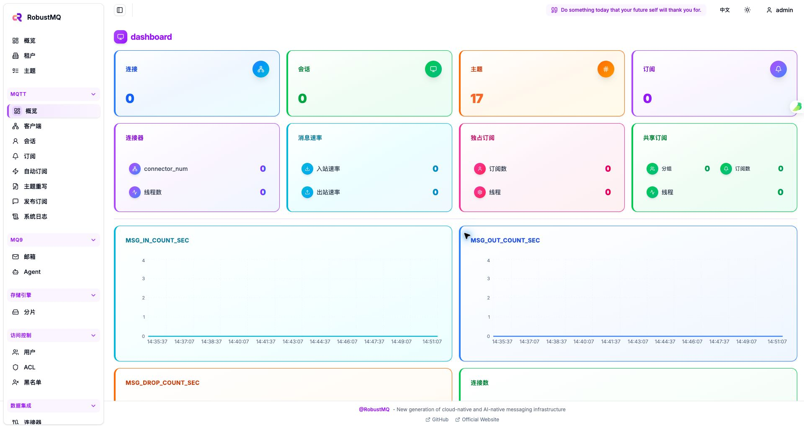
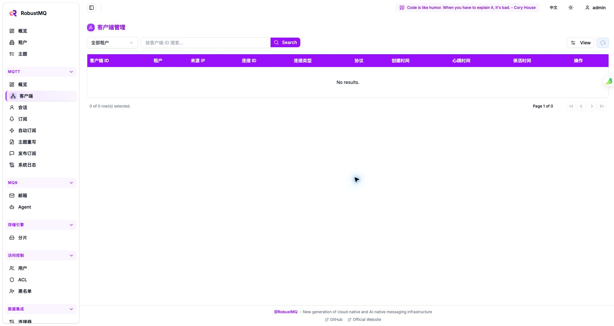

# Dashboard

RobustMQ Dashboard 是随完整二进制包提供的 Web 控制台，用于查看集群、节点、MQTT 客户端、
主题、订阅、ACL、连接器和运行指标等信息。控制台通过 RobustMQ 的 Admin HTTP API 工作。

## 页面截图

MQTT 概览页展示连接、会话、主题、订阅和消息速率等指标：



客户端管理页提供租户筛选、客户端 ID 搜索和连接信息列表：



## 访问已打包的控制台

只有包含 `dist/` 的完整包才会提供页面。构建、解压并启动：

```bash
make build-full
tar -xzf build/robustmq-0.4.11-darwin-arm64.tar.gz
cd robustmq-0.4.11-darwin-arm64
./bin/robust-server start
```

然后打开：

```text
http://127.0.0.1:58080/
```

默认登录凭据取自 `config/server.toml` 的 `admin` 配置。开发或测试配置通常为：

```text
用户名：admin
密码：admin
```

生产环境请在启动前修改密码和 JWT secret。

启动脚本会读取 `http_port`，并在 `dist/config.js` 中写入运行时 API 配置。因此，修改 Admin
HTTP 端口后不需要重新编译前端。控制台会使用当前页面主机的配置端口访问后端。

## 前后端分开开发

先启动 RobustMQ 后端，再启动前端开发服务器：

```bash
# 终端 1：RobustMQ 后端
cargo run --package cmd --bin broker-server -- --conf=config/server.toml

# 终端 2：Web 控制台
git clone https://github.com/robustmq/robustmq-copilot.git
cd robustmq-copilot
pnpm install
ROBUSTMQ_API_PORT=58080 pnpm ui:dev
```

开发页面默认在 `http://127.0.0.1:4000/`。跨主机开发时使用完整后端地址：

```bash
ROBUSTMQ_API_URL=http://192.168.1.10:58080 pnpm ui:dev
```

`ROBUSTMQ_API_URL` 优先于 `ROBUSTMQ_API_PORT`。Admin HTTP 已启用 CORS，前端开发服务器不需要
额外代理。

## 检查连接

```bash
curl -i http://127.0.0.1:58080/health/ready
curl -i http://127.0.0.1:58080/
```

`/health/ready` 应返回 `HTTP 200`，根路径应返回 `text/html`。登录后，控制台会自动在请求中
携带 Admin HTTP 返回的 bearer token。

如果根路径返回 `404`，通常是因为使用了 `make build` 生成的不含前端的 API-only 包，或者
启动时的当前目录不是包含 `dist/` 的包根目录。此时 `/health/ready` 和 API 仍可能正常；需要
页面时请使用 `make build-full`，并从完整包根目录执行 `robust-server start`。

## 停止服务

```bash
./bin/robust-server stop
```

## 后续完善

- [ ] 页面结构与导航
- [ ] 常见运维操作入口
- [ ] 典型使用流程
